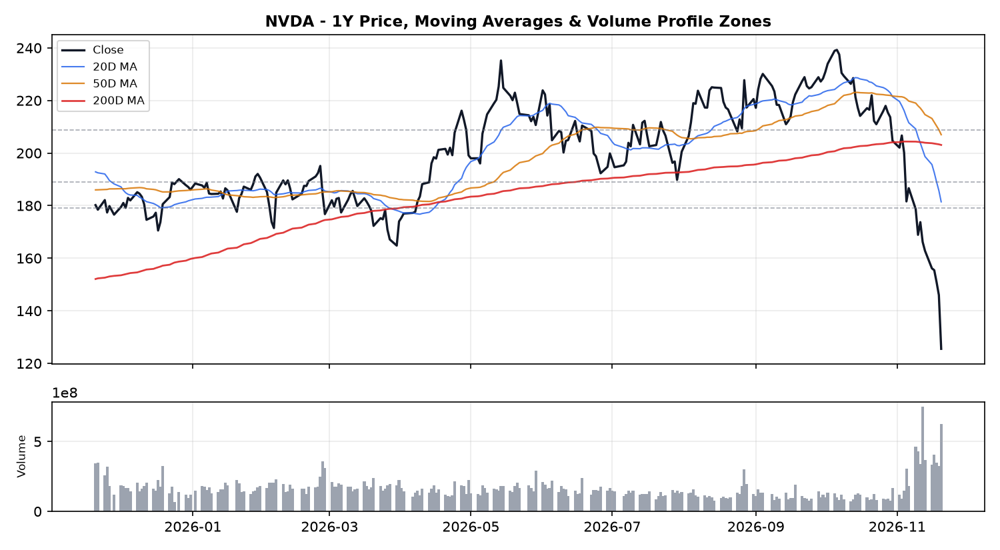

# 04 주가·수급과 최종 투자 판단

## 1 추세와 시장의 반응

### 가격은 실적 호조보다 위험을 먼저 반영한다

[AI추론] 11월 20일 종가 125.53달러는 최근 20거래일 평균 181.46달러보다 낮다. 기존 엔진의 50일·200일 평균도 모두 위에 있다. 단기는 급락, 중기는 추세 훼손으로 해석한다. 1년 차트에서는 이전 상승 흐름의 중요한 지지 구간을 이탈했다. 다년 주봉·월봉 원시 자료는 확보하지 못해 장기 대세 전환을 정밀 판정하지 않는다.

데이터 기준일: 2026-11-22. 가격 종료일: 2026-11-20. [AI추론] 기존 Python 엔진 L01 생성 차트. 전체 일별 원자료가 보존되지 않아 이번 실행에서 재현하지 못한 참고 그림이다. 20일 평균과 최신 거래량은 S26으로 별도 검산했다. 점선은 일별 종가에 거래량을 배정한 근사 매물대이며 실제 장중 가격별 체결 분포가 아니다.

| 기술 지표 | 값 | 자료·해석 |
| --- | --- | --- |
| 종가 | 125.53달러 | S26 정규장 종가 |
| 20일 평균 | 181.46달러 | S26 최근 20거래일로 재계산 |
| 50일 / 200일 평균 | 207.00 / 203.09 | L01, 이번 실행 전체 검산 불가 |
| 200일 평균 이격 | -38.19% | L01; 큰 이격이 즉시 반등을 보장하지 않음 |
| 14일 RSI | 13.7 | L01 단순평균 방식, Wilder 방식과 다름 |
| 52주 고가 / 저가 | 243.37 / 124.50 | L01 조정 가격 계열 기준 |
| 52주 범위 내 위치 | 0.9% | L01 최저점 근처 |
| 11월 20일 거래량 | 633.3백만 주 | S26, 이전 업체 집계와 차이 |
| 20일 평균 대비 거래량 | 2.20배 | S26 최신일 포함 20거래일로 재계산 |

데이터 기준일: 2026-11-22. [AI추론] 기술 지표와 비율은 fact_sheet.json. 서로 다른 공급업체 거래량을 섞어 배수를 계산하지 않음.

[AI추론] RSI가 낮다는 사실은 최근 하락의 강도를 보여줄 뿐 저평가 증거는 아니다. 악재로 기업가치 추정이 내려가는 구간에서는 과매도가 오래 지속될 수 있다. 최신 거래량이 평균보다 큰 급락은 위험 재평가가 활발했다는 뜻이지만, 거래량만으로 기관 순매도나 특정 투자자의 매매를 식별할 수 없다.

### 지지·저항과 매물대의 한계

| 가격 구간 달러 | 역할 | 행동 기준 |
| --- | --- | --- |
| 124.50 부근 | 52주 저점 참고 지지 | 거래량 동반 이탈 시 단기 바닥 가설 철회 |
| 174.03~183.93 | 기존 매물대·20일선 인근 | 회복 후 안착 여부 확인 |
| 183.93~193.84 | 이전 거래 집중 구간 | 반등 시 매도 압력 가능 |
| 203.75~213.65 | 중기 이동평균·거래 집중 구간 | 추세 정상화의 더 높은 확인 구간 |
| 100~110 | 가치평가상 조건부 검토 구간 | 차트 지지선이 아님; 공시·현금 조건 먼저 충족 |

데이터 기준일: 2026-11-22. [AI추론] L01 매물대는 12개 가격 구간에 일별 전체 거래량을 종가로 배정한 대용치. 마지막 행은 [AI추론] 투자 검토 가격.

[AI추론] 근사 매물대는 이전에 거래가 많이 이뤄진 가격대를 보여주지만 모든 투자자의 실제 원가를 뜻하지 않는다. 특히 장중 변동이 큰 날은 종가에 거래량을 몰아 넣는 방식의 오차가 커진다. 따라서 이 선을 정밀 주문 가격으로 쓰기보다 반등 시 매도 압력이 생길 수 있는 구간으로 활용한다.

[AI추론] 현재 가격에서는 신규 매수를 보류하므로 손절 주문을 자동 생성하지 않는다. 향후 매수 검토 시 저점 이탈은 가격 시나리오를 재평가하는 신호이며, 회계·현금 논리가 깨지면 가격 반등과 무관하게 투자 가설을 폐기한다. 가격 기준과 사업 기준을 둘 다 둬야 급락을 계속 저가매수 기회로 오인하지 않는다.

### 사건과 주가·거래량

| 사건·거래일 | 종가 변화 | 해석 범위 |
| --- | --- | --- |
| 11월 12일 CEO 전환 발표 | -4.34% | 리더십 위험 재평가와 시간상 일치 |
| 11월 17일 실적 → 18일 | -2.89% | 실적 상회에도 다음 날 하락 |
| 11월 20일 회계 조사 보도 | -14.01% | 대량 거래와 급락; 단일 원인 효과 확정 불가 |
| 실적 발표일 → 11월 20일 | -19.25% | 실적·마진·경영·규제 정보가 겹친 기간 |

데이터 기준일: 2026-11-22. [AI추론] S11~S14, S26. 종가 대 종가 변화이며 장중·시간외 수익률이 아님. 사건 날짜의 일치가 인과관계 증명은 아님.

[AI추론] 앞으로 2~4개 분기의 실적 성장은 낮은 선행 PER에도 이미 일부 반영돼 있다. Reverse DCF가 요구하는 FCFF 성장률 25.3%는 '시장에 성장 기대가 없다'는 주장과 맞지 않는다. 시장이 반영하는 것은 성장 소멸보다는 그 성장의 현금성과 지속성에 대한 할인이다. 공시와 회수 개선 없이 이익 추정치만 올라가면 주가가 같은 비율로 오르지 않을 수 있다.

## 2 기관투자자에게 적합한 역할

[AI추론] 편입 논리는 AI 인프라의 핵심 공급자라는 위치, 높은 영업 마진, 개발자·시스템 생태계, 절대 규모가 큰 현금 창출이다. 대형 운용사는 직접 모든 기술 승자를 고르지 않아도 NVDA를 통해 여러 고객의 AI 투자 확대에 노출될 수 있다. 경쟁력만 평가하면 장기 관찰 대상에서 제외할 이유는 약하다.

[AI추론] 회피·비중 축소 논리는 성장주와 고객 금융지원 위험이 한 종목에 겹친다는 점이다. 위험 예산을 사용하는 대형 자산운용사라면 미확인 보증과 회계 이슈가 해소될 때까지 허용 노출을 낮게 둘 이유가 있다. 벤치마크 비중을 맞추려는 보유와 적극적 초과수익 목적의 신규 편입은 별개의 판단이다. 사용자의 전체 자산·보유비중을 알지 못하므로 개인별 적정 비중을 제시하지 않는다.

[AI추론] 현재 분류는 '고성장주'가 가장 가깝고, 대규모 고객 설비투자에 연동되는 시클리컬 특성이 강하다. 기술 경쟁력이 뛰어나도 현금·자본배분의 일관성이 아직 불확실해 안정적인 퀄리티 컴파운더로 단정하지 않는다. 가격 추세가 훼손된 상태여서 모멘텀 추종 매수 논리도 약하다. 수익성 회복이 필요한 전통적인 턴어라운드 기업과도 다르다.

## 3 Bull과 Bear의 세 가지 정면 논쟁

### 논쟁 1: 실적 호조는 신뢰 회복의 증거인가

[AI추론] Bull: 최신 매출과 영업이익은 고객이 여전히 제품을 필요로 한다는 강한 증거다. 제품 전환에서도 높은 마진을 내고 있어 경영진 변화가 기술 경쟁력을 즉시 훼손했다고 볼 수 없다. 수요가 유지되는 동안 지나친 위험 할인은 정상화될 수 있다.

[AI추론] Bear: 매출과 이익이 좋아도 채권·재고·고객 지원이 늘면 주주 현금은 다르다. 고객에게 투자하거나 구매를 지원하는 구조에서는 판매 성과만으로 독립적 수요를 입증하기 어렵다. 차기 주석과 회수 실적을 먼저 확인해야 한다.

[AI추론] 판정: 제품 수요에 대해서는 Bull의 근거가 강하고, 신규 매수 시점에 대해서는 Bear의 검증 요구가 더 설득력 있다. 매출 상회만으로 현금 논쟁을 끝낼 수 없다.

### 논쟁 2: 낮은 배수는 충분한 안전마진인가

[AI추론] Bull: 경쟁사보다 낮은 평가배수와 큰 절대 FCF가 손실 완충 역할을 한다. 불확실성이 완화되면 이익 증가와 멀티플 정상화가 함께 작동할 수 있다.

[AI추론] Bear: GAAP 순이익에 투자평가이익이 들어가고 선행 추정치가 높은 성장을 요구한다. DCF의 현재가치가 시장가보다 낮아, 낮은 PER을 기업가치의 할인으로 바로 해석할 수 없다. 높은 성장과 정상 마진이 동시에 흔들리면 배수 할인만으로 보호되지 않는다.

[AI추론] 판정: 현재가에서는 Bear 우위다. 낮은 배수는 조사할 이유이지 곧바로 매수할 이유는 아니다. DCF와 현금 회수에서 안전마진을 확인해야 한다.

### 논쟁 3: CUDA의 해자는 ASIC 경쟁을 막는가

[AI추론] Bull: 모델이 바뀌고 작업이 다양할수록 범용 GPU와 풍부한 도구의 가치가 높다. 전체 시스템의 안정성과 개발 시간을 고려하면 칩 가격만 싼 대안이 반드시 경제적인 것은 아니다.

[AI추론] Bear: 반복 추론은 작업이 안정되면서 맞춤형 ASIC에 유리해질 수 있다. 최대 고객이 직접 설계 역량을 키우면 NVDA 매출이 늘어도 성장률·가격결정력은 내려갈 수 있다. 통합 플랫폼 해자가 모든 작업을 영구 독점하는 해자는 아니다.

[AI추론] 판정: 단기간의 경쟁력은 Bull 우위이나 장기 마진은 보수적으로 둬야 한다. Base DCF의 영업이익률 하락 경로는 이 경쟁 가능성을 반영한다.

## 4 최종 실행 계획: 관망

### 핵심 투자포인트

[AI추론] 첫째, GPU·CUDA·네트워크를 묶는 통합 경쟁력은 고객의 도입 비용을 줄이고 높은 마진을 지지한다. 둘째, AI 학습에서 추론·기업 활용으로 수요가 확장되면 플랫폼 교체와 증설이 이어질 수 있다. 셋째, 큰 절대 OCF는 기술 투자와 주식수 관리를 가능하게 한다. 넷째, 현금·공시 신뢰가 회복되면 낮아진 상대 평가배수가 재평가될 여지가 있다. 이 네 가지는 관찰을 지속할 이유이며 현재 매수를 확정하는 조건은 아니다.

### 최우선 위험 세 가지

[AI추론] 고객의 현금 회수와 금융지원 부담, 리더십·공시 신뢰 훼손, 수요·마진 둔화와 공급 약정 손실의 결합을 가장 경계한다. 기술이 우수해도 이 위험이 현실화되면 주주가 받는 현금과 적용 배수가 동시에 낮아진다.

### 다음 분기에 확인할 다섯 KPI

| KPI | 현재 기준·계획 | 판단을 개선할 조건 |
| --- | --- | --- |
| 1 매출과 핵심 제품 | Q4 130십억 ±3% 계획 | 계획 달성 + 반복 고객 현금 구매 |
| 2 GAAP GPM | Q4 71~72% 계획 | 전환 이후 안정; FY28 72~73% 회사 설명 검증 |
| 3 DSO | 63.7일 근사치 | 60일 아래로 개선; 결제조건 악화 없음 |
| 4 OCF / 순이익 | 0.74배 최근 분기 | 0.80배 이상 회복, 투자이익 효과 분리 |
| 5 투자·지원 현금 노출 | 지분 취득/FCF 9개월 51.1% | 30% 미만으로 낮아지고 보증 최대 노출 명확화 |

데이터 기준일: 2026-11-22. [AI추론] 실제값·회사 계획 S04~S07. 개선 경계는 [AI추론] 관찰 규칙이며 회사 가이던스가 아님. 비율은 엔진 산출.
| 평가 항목 | 가격 달러 | 현재가 대비 |
| --- | --- | --- |
| 현재 종가 | 125.53 | 기준 |
| Base DCF 현재가치 | 114.33 | -8.9% |
| Bull 12개월 목표 | 268.35 | 113.8% |
| Base 12개월 목표 | 158.55 | 26.3% |
| Bear 12개월 목표 | 63.61 | -49.3% |
| 확률가중 12개월 목표 | 157.51 | 25.5% |

데이터 기준일: 2026-11-22. [AI추론] [AI추론] 가격 수익률이며 배당·비용·환율 제외. DCF와 12개월 PER 목표는 서로 다른 평가 방법·시점.

[AI추론] 최종 의견은 관망이다. 현재 125.53달러에서 Base 상승여력 26.3%에 비해 Bear 하락위험 -49.3%가 크고, 손익비는 0.53배다. 확률가중 기대수익률이 양수여도 큰 사건 위험과 확률 오차를 감안하면 즉시 신규 매수의 보상이 충분하지 않다.

[AI추론] 조건부 검토 구간은 100~110달러다. 이는 차트에서 관측된 지지선이나 자동 주문이 아니라 Base DCF보다 낮은 가격에서 다시 검토하겠다는 규율이다. 최신 10-Q의 계약·보증 가시성 개선, 현금 회수 안정, 영구 CEO·제품 실행 체계의 신뢰가 선행 조건이다. 가격만 이 구간에 도달하고 사업 가설이 악화하면 매수하지 않는다.

[AI추론] 반대로 가격이 먼저 상승하더라도 현금 회수와 경영·공시 신뢰가 확인되면 모델을 상향해 새로운 진입 구간을 계산할 수 있다. 좋은 기업을 고정 가격에 묶어두기보다 검증된 이익·현금 경로에 따라 가치를 갱신하는 편이 합리적이다. 이 보고서는 매매 실행 없이 기업가치와 관찰 조건을 제시하는 리서치다.
