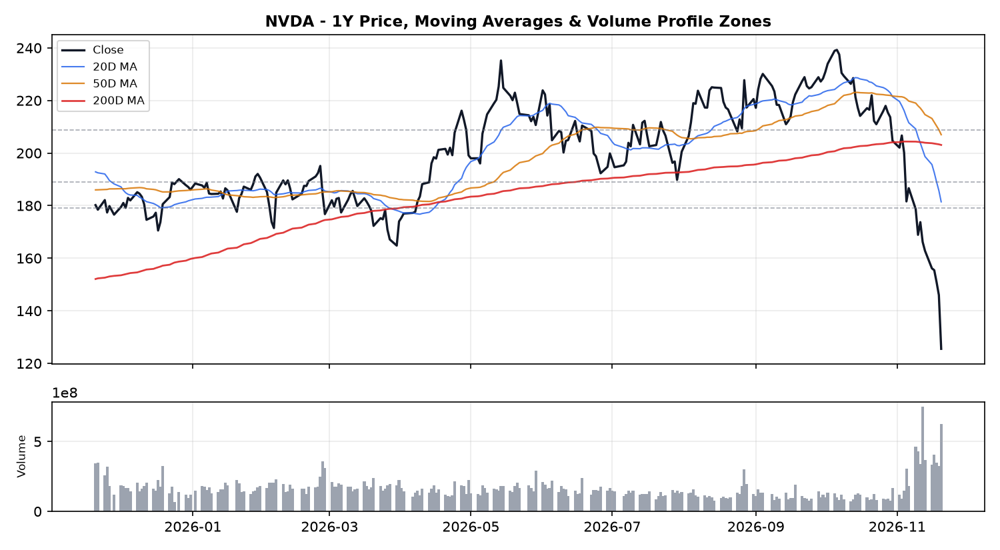

데이터 기준일: 2026-11-22 | 작성 완료: 2026-11-23

# NVIDIA | NVDA

## 강한 제품, 현금과 신뢰의 검증이 먼저다

미국 상장주식 심층 분석 · USD · 기준 가격: 2026-11-20 정규장 종가

[AI추론] 투자 의견: 관망. 성장과 기술 해자는 유효하지만, 고객 금융지원·운전자본·경영 및 공시 불확실성 때문에 현재 가격의 안전마진이 충분하지 않다.

| 판단의 기준 | 값 |
| --- | --- |
| 주가 | 125.53달러 |
| Base DCF 현재가치 | 114.33달러 |
| 12개월 Base 목표가 | 158.55달러 |
| Bull / Bear 목표가 | 268.35 / 63.61달러 |
| Base 상승폭 / Bear 하락폭 | 0.53배 |
| 조건부 검토 가격 | 100~110달러, 공시·현금 조건 충족 시 |

데이터 기준일: 2026-11-22. [AI추론] 종가 S26, 가치평가·판단은 fact_sheet.json에 기록한 [AI추론] 가정. 목표가는 보장 수익이 아님.

[회사주장] FY2027 3분기 매출은 115.844십억 달러, GAAP 영업이익은 77.520십억 달러다. [AI추론] 제품 수요는 강하지만 최근 12개월 OCF/순이익은 0.70배다. 투자평가이익을 제거하고 운전자본·고객 지원을 반영하면 낮은 PER만큼 저렴하다고 판단하기 어렵다. [S04, S05]

[공시사실] 최근 CEO 교체가 공시됐다. [AI추론] 회계 조사에 관한 언론 보도와 별도 규제기관의 자료 요구는 위험 신호지만 위반 확정으로 해석하지 않는다. 확정 사실과 회사 전망, 분석 가정을 본문에서 구분한다. [S11~S14]

최신 분기 자료는 미감사 실적 보충자료다. 해당 분기의 10-Q 주석은 미확보 상태다. 일부 과거 분기 잔액 및 장기 기술 지표는 기존 자료를 사용했으며 한계를 해당 표에 표시했다. 자료 기준일 이후 발생한 새 정보는 이 고정 기준 보고서에 포함하지 않았다.

금액 표는 기본적으로 십억 달러다. '공시사실'은 법정 공시, '회사주장'은 IR·계획, '시장컨센서스'는 외부 집계, '증권사추정'은 산업 리서치 포함, 'AI추론'은 계산·해석·모델 가정을 뜻한다.

# 01 사업모델과 산업 경쟁력

## 1 수익 창출 구조와 매출 방정식

[공시사실] NVIDIA는 GPU 설계와 CUDA 소프트웨어를 중심으로 데이터센터 컴퓨팅, 네트워킹, 게임·전문시각화 및 자동차 플랫폼을 판매한다. 제품은 클라우드 사업자뿐 아니라 ODM·OEM·유통업체를 거쳐 최종 고객에게 공급된다. 따라서 직접 고객의 매출 비중과 실제 AI 서비스를 운영하는 최종 고객의 비중은 같은 개념이 아니다. [S01]

[AI추론] 투자 판단의 출발점은 칩 한 개의 가격보다 고객의 전체 시스템 도입 비용이다. GPU는 많은 계산을 동시에 처리하는 작업반, CUDA는 그 작업반이 같은 규칙으로 일하게 만드는 공용 작업 지침, NVLink와 네트워크는 작업반 사이의 고속 운반 통로에 해당한다. 고객은 개별 부품보다 모델 학습과 추론을 끝내는 시간, 전력, 안정성을 산다. 이 통합 가치가 유지되면 높은 마진을 지킬 수 있지만, 고객의 실제 서비스 수익이 투자비를 따라오지 못하면 주문이 일시에 줄어들 수 있다.

[공시사실] 하드웨어 매출은 일반적으로 제품의 통제가 고객에게 이전되는 시점에 인식하고, 소프트웨어·지원 서비스는 계약상의 수행의무에 따라 기간에 걸쳐 인식한다. 기업이 자체 공장을 보유하지 않는 팹리스 구조라는 사실은 생산설비 투자가 적다는 뜻이지 공급계약 위험이 없다는 뜻은 아니다. [S01, S07]

[AI추론] 매출 방정식은 제품군별 단가 × 출하량의 합계에 소프트웨어·지원 매출을 더한 형태가 적절하다. 더 비싼 랙 시스템 판매가 늘면 제품 믹스만으로 평균 판매단가가 상승한다. 이 효과를 기존 GPU 가격 인상과 혼동하면 가격 전가력을 과대평가하게 된다.

### 최근 성장의 정량 분해

| 회계연도 | 총매출 십억 달러 | 매출 YoY | 데이터센터 매출 | 데이터센터 비중 |
| --- | --- | --- | --- | --- |
| FY2024 | 60.92 | 125.9% | 47.52 | 78.0% |
| FY2025 | 130.50 | 114.2% | 115.19 | 88.3% |
| FY2026 | 215.94 | 65.5% | 193.74 | 89.7% |

데이터 기준일: 2026-11-22. [AI추론] S01 공시 원자료, fact_sheet.json 비율 계산. GAAP 매출.

[AI추론] FY2025와 FY2026 총매출 증가액 중 데이터센터 증가액의 기여도는 각각 97.2%와 91.9%다. 사업 포트폴리오 변화가 성장을 설명하는 핵심이다. 다만 공개 공시에는 세대별 출하량과 일관된 ASP 시계열이 없어 P와 Q의 기여율을 수치로 분리할 수 없다. 출하 확대와 고가 시스템 믹스가 함께 작용했다는 판단까지 가능하며, 특정 비율을 임의 배정하지 않는다. [S01]

[회사주장] 최신 분기 데이터센터 매출은 약 107.6십억 달러, Edge Computing은 약 8.2십억 달러다. Rubin 플랫폼의 첫 생산 출하 분기 매출은 약 20십억 달러라고 설명했다. 이는 회사 설명이며 제품별 독립 수익성이나 고객 현금 회수를 보증하지 않는다. [S04, S06]

[AI추론] 최신 분기 데이터센터 비중은 약 92.9%로 높다. 제품 전환의 성공은 매출 성장에 유리하지만, AI 인프라 투자 한 종류에 대한 의존도도 함께 커진다. 종전 Gaming·자동차 분류와 최신 Edge Computing 분류를 기계적으로 이어 붙여 성장률을 계산하지 않는다.

### 제품 지역 고객 집중도

| FY2026 제품군 | 매출 십억 달러 | 전체 비중 |
| --- | --- | --- |
| Data Center | 193.74 | 89.7% |
| Gaming | 16.04 | 7.4% |
| ProViz | 3.19 | 1.5% |
| Auto | 2.35 | 1.1% |
| OEM Other | 0.62 | 0.3% |

데이터 기준일: 2026-11-22. [AI추론] S01 Note 17. 제품군은 시장별 분류이며 보고부문과 다름.
| FY2026 고객 본사 지역 | 매출 십억 달러 | 전체 비중 |
| --- | --- | --- |
| US | 149.62 | 69.3% |
| Taiwan | 42.34 | 19.6% |
| China HK | 19.68 | 9.1% |
| Other | 4.30 | 2.0% |

데이터 기준일: 2026-11-22. [AI추론] S01 Note 17. 배송지·최종 소비지 기준이 아님.
| 직접 고객 집중도 | 확인된 공시 | 해석 제한 |
| --- | --- | --- |
| FY2026 Top 1 | 22% | 고객 실명 미공개 |
| FY2026 두 번째 고객 | 14% | 최종 소비자와 동일하다고 단정 불가 |
| FY2026 Top 3 및 Top 5 | 확인 불가 | 다른 고객 비중을 추정해 합산하지 않음 |
| FY2025 주요 고객 | 12%, 11%, 11% | 연도별 익명 고객의 동일성 불확실 |

데이터 기준일: 2026-11-22. [공시사실] S01 Note 17. [공시사실] 직접 고객 기준.

[공시사실] 회사는 FY2026 3분기부터 지역별 매출을 고객 청구지 대신 고객 본사 소재지 기준으로 바꾸고 비교연도를 재작성했다. 대만 고객의 주문은 미국·유럽 최종 수요를 포함할 수 있다. [S01]

[AI추론] 미국 비중 상승을 전부 미국 내부 수요 증가로 해석하거나, 싱가포르 항목이 사라졌다는 사실만으로 매출 조작을 결론 내리면 안 된다. 분류 변경은 지리적 위험의 가시성을 낮출 수 있으므로 배송지, 최종 고객, 수출 허가를 함께 봐야 한다. 집중 고객의 주문 중단과 지급 지연은 전체 이익에 동시에 영향을 줄 수 있다.

## 2 시장 규모와 밸류체인의 병목

### 전체 시장과 실제 접근 가능한 시장

| 시장 범위 | 2026년 십억 달러 | 2027년 십억 달러 | 근거 수준 |
| --- | --- | --- | --- |
| 전체 AI 인프라 지출 | 1,563.0 | 2,397.0 | [증권사추정] Gartner |
| AI 최적화 서버 지출 | 527.6 | 957.2 | [증권사추정] Gartner |

데이터 기준일: 2026-11-22. [증권사추정] S16. 캘린더 연도 전망이며 NVIDIA 회계연도 매출과 직접 나눠 점유율을 산출하지 않음.

[AI추론] AI 인프라는 서버 이외의 설비·네트워크 등을 포함하므로 이 전체를 NVIDIA의 판매 가능 시장으로 잡으면 과대평가한다. AI 최적화 서버도 OEM의 조립·메모리·전원 비용 등을 포함하므로 NVIDIA가 전부 가져가는 시장이 아니다. 시장 통계의 범위와 회사 매출 인식 단계가 다르다는 점이 중요하다.

[AI추론] 동일 정의의 공개 5년 전망을 확보하지 못해 장기 수치는 분석 가정으로 분리했다. 2026년 AI 인프라 지출을 기준으로 5년 CAGR 20%를 가정하면 2031년 규모는 3,889.2십억 달러다. 서버 지출 중 칩·네트워크·플랫폼 공급자가 접근할 수 있는 비중을 65%로 가정한 SAM 대용치는 2026년 342.9십억 달러, 같은 CAGR 적용 시 2031년 853.3십억 달러다. 이는 Gartner의 2031년 예측이나 공식 SAM이 아니다. 네트워크의 별도 시장을 중복 합산하지 않았으며, 범위 차이 때문에 이 SAM을 DCF 매출의 상한으로 사용하지 않는다.

[AI추론] 투자적 함의는 큰 시장 자체보다 성장의 재원이다. 장기 수요가 실제 유료 추론 매출로 연결되어야 고객이 GPU를 교체하고 확대한다. 구매자의 자금 조달과 가동률이 약해지면 큰 TAM과 NVDA의 단기 주문은 동시에 성장하지 않을 수 있다.

### 가치사슬과 초과이익의 위치

[AI추론] 소재·장비 → 파운드리와 첨단 패키징·HBM → NVIDIA 설계·CUDA·시스템·네트워크 → ODM·OEM·클라우드 → 모델 개발사·기업 사용자.

[AI추론] NVIDIA는 설계·소프트웨어·시스템 통합의 중앙에 있다. 자체 반도체 공정을 소유하지 않아도 고객의 개발 환경과 시스템 구성을 통제해 경제적 가치를 확보한다. 다만 첨단 패키징·HBM 생산과 데이터센터 전력 공급은 다른 주체가 쥐고 있다. 주문이 충분해도 메모리와 전력이 부족하면 시스템을 인도하거나 가동하지 못한다. 수도꼭지를 크게 만들어도 상수도관과 물탱크가 부족하면 공급량이 늘지 않는 것과 같다.

[공시사실] FY2027 2분기 공급·생산능력 약정은 279십억 달러였고, [회사주장] 최신 어닝콜에서는 390십억 달러로 증가했다고 설명했다. 이 숫자는 고객 수주잔고가 아니라 회사의 조달 약정이다. [S07, S06]

[AI추론] 생산능력을 먼저 확보하면 경쟁사보다 빨리 매출을 올릴 수 있다. 반면 주문 취소가 발생하면 공급 약정은 재고 평가손실이나 취소 비용으로 돌아온다. 병목을 확보하는 강점과 고정 부담이 함께 커진다. 다음 분기에는 출하 지연뿐 아니라 기존 주문 가격으로 비싼 메모리 비용을 흡수하는지 확인해야 한다.

### 핵심 기술과 경쟁 구도의 변화

[AI추론] GPU는 여러 종류의 문제를 병렬 처리하는 범용 도구다. ASIC은 특정 작업만 빠르게 하는 전용 기계다. 모델과 계산 방식이 자주 바뀌면 유연한 GPU가 유리하고, 반복 작업이 안정되면 자체 ASIC이 비용을 줄일 수 있다. 따라서 추론 시장이 커진다는 사실만으로 GPU 점유율이 유지된다고 단정할 수 없다.

[회사주장] AMD는 Instinct와 EPYC, Helios 시스템 확대를 강조하고, Broadcom은 맞춤형 AI 가속기와 네트워킹 성장을 제시한다. [AI추론] 두 회사는 NVIDIA의 전체 시스템을 그대로 대체하기보다 특정 고객과 작업을 먼저 공략할 수 있다. NVDA의 방어력은 벤치마크 속도 하나가 아니라 모델 이전 비용, 개발자 도구, 네트워크 효율, 공급 안정성의 합이다. [S17, S18]

## 3 경제적 해자 평가

### 경쟁우위 스코어카드

[AI추론] 각 항목은 0~10점의 상대 평가다. 총점은 9개 항목의 단순 평균이며 실증적 신용등급이나 투자 수익 예측이 아니다. NVIDIA의 기술 우위와 경영진·회계 위험은 분리해서 평가한다.

| 항목 | NVIDIA | AMD | Broadcom |
| --- | --- | --- | --- |
| 핵심 기술과 R&D 효율 | 9 | 8 | 8 |
| 특허와 지식재산 장벽 | 8 | 8 | 8 |
| 고객 인증과 검증 | 9 | 7 | 9 |
| 고객 전환비용 | 9 | 6 | 8 |
| 개발자 네트워크 효과 | 9 | 6 | 6 |
| 규모의 경제 | 10 | 7 | 8 |
| 구조적 원가우위 | 8 | 7 | 8 |
| 시스템 수직 통합 | 9 | 6 | 7 |
| 공급망 통제력 | 7 | 6 | 7 |
| 종합 10점 만점 | 8.67 | 6.78 | 7.67 |

데이터 기준일: 2026-11-22. [AI추론] S01, S07, S17, S18을 바탕으로 평가. 점수 및 평균은 fact_sheet.json.

[AI추론] 기술·R&D: NVDA는 GPU와 소프트웨어·통신을 함께 최적화한다. AMD는 CPU·GPU 설계 경쟁력이 높고, Broadcom은 고객별 ASIC 설계와 통신에 강하다. 연구개발비가 크다는 사실만으로 효율을 판정하지 않고 제품 출시 후 마진과 현금창출로 이어지는지 본다.

[AI추론] 특허·인증: 세 회사 모두 설계 자산과 고객 검증 과정이 진입장벽이다. 랙 단위 시스템은 열·전력·네트워크 검증을 함께 거쳐야 한다. 다만 업체별 인증 기간의 동일 기준 통계는 공개되지 않아 몇 개월이라는 수치를 넣지 않았다. 이미 확보한 고객이 새 세대에도 자동 승인한다는 가정은 배제한다.

[AI추론] 전환비용·네트워크: CUDA에 맞춰 개발·검증한 코드를 옮기려면 재작성, 성능 조정, 장애 검증이 필요하다. 개발자가 많으면 도구와 사례가 쌓여 신규 고객의 도입 비용도 낮아진다. 그러나 오픈소스 컴파일러와 프레임워크가 장벽을 낮출 수 있다. Broadcom의 전환비용은 공개 개발자 생태계보다 고객별 설계 공동작업에서 발생한다.

[AI추론] 규모·원가: 큰 주문은 공급 확보와 개발비 분산에 유리하다. 그렇다고 NVDA의 칩 제조원가가 항상 경쟁사보다 낮다는 뜻은 아니다. NVDA의 원가우위는 고객 관점의 계산 한 건당 총비용에서 평가해야 한다. 맞춤형 ASIC은 범위가 좁은 작업에서 더 싼 대안이 될 수 있다.

[AI추론] 수직 통합·공급망: NVIDIA는 칩, CPU, 네트워크, 라이브러리, 랙 설계를 묶지만 파운드리까지 소유하지 않는다. 통합 범위는 넓으나 생산 주권은 제한적이다. 장기 약정은 공급 안정성을 높이는 동시에 수요가 꺾일 때 자본배분의 약점이 된다.

### 마진과 시장점유율로 검증

| 비교 지표 | NVIDIA FY27Q3 | AMD 2026Q3 |
| --- | --- | --- |
| GAAP 매출 십억 달러 | 115.84 | 13.38 |
| GAAP GPM | 74.8% | 53.9% |
| GAAP OPM | 66.9% | 21.2% |

데이터 기준일: 2026-11-22. [AI추론] S04, S17. AMD 전체 사업과 NVDA 전체 사업의 믹스 차이를 포함하므로 순수 GPU 비교가 아님.

[AI추론] NVDA의 GAAP GPM은 AMD보다 20.9%p 높다. 통합 시스템·소프트웨어 가치와 제품 믹스가 가격에 반영된 결과로 해석할 수 있지만, 이 차이를 모두 CUDA의 효과로 귀속할 수 없다. Broadcom도 소프트웨어 사업이 섞여 있어 전사 마진을 GPU 마진과 직접 비교하기 어렵다.

[AI추론] 일관된 정의의 AI 가속기 시장점유율 시계열은 확보하지 못했다. NVDA 데이터센터 매출의 큰 규모는 지배력을 뒷받침하지만, 그것이 시장점유율 상승률을 증명하지는 않는다. 특히 경쟁사 ASIC과 NVDA 시스템은 판매 단위가 다르다. 해자 유지의 실무적 검증은 신규 시스템 도입, 고객의 재구매, GPM 및 현금 회수의 동시 유지다. 현재 사업 경쟁력은 높지만 이 사실만으로 현재 가격에서의 신규 매수를 정당화하지 않는다.

# 02 재무 성과와 이익의 질

## 1 최근 5개년과 8개 분기의 연결 분석

[AI추론] 이하 금액은 별도 표시가 없으면 십억 달러, 주식수는 십억 주, EPS는 달러다. FY는 1월 말 종료 회계연도다. FY2026은 2026년 1월 25일 종료했으며 캘린더 2026년 실적과 다르다. GAAP 손익과 현금흐름을 기본으로 하고, FCF·영업 EBITDA·ROIC는 별도 산식으로 계산했다. 단순히 순이익이 늘었다는 사실보다 현금 회수와 자본 투입을 동시에 살펴본다.

### 연간 손익 추이: GAAP

| 항목 | FY2022 | FY2023 | FY2024 | FY2025 | FY2026 |
| --- | --- | --- | --- | --- | --- |
| 매출 | 26.91 | 26.97 | 60.92 | 130.50 | 215.94 |
| 매출 YoY | 확인 불가% | 0.2% | 125.9% | 114.2% | 65.5% |
| 매출총이익률 | 64.9% | 56.9% | 72.7% | 75.0% | 71.1% |
| 영업이익 | 10.04 | 4.22 | 32.97 | 81.45 | 130.39 |
| 영업이익률 | 37.3% | 15.7% | 54.1% | 62.4% | 60.4% |
| 순이익 | 9.75 | 4.37 | 29.76 | 72.88 | 120.07 |
| 희석 EPS | 0.385 | 0.174 | 1.190 | 2.940 | 4.900 |

데이터 기준일: 2026-11-22. [AI추론] S01~S03. FY2022 YoY는 비교연도 미수집. EPS는 주식분할 조정. GAAP 원자료와 엔진 계산.
| 항목 | FY2022 | FY2023 | FY2024 | FY2025 | FY2026 |
| --- | --- | --- | --- | --- | --- |
| 영업현금흐름 OCF | 9.11 | 5.64 | 28.09 | 64.09 | 102.72 |
| 설비투자 CapEx | 0.98 | 1.83 | 1.07 | 3.24 | 6.04 |
| 금융리스 등 원금 | 0.08 | 0.06 | 0.07 | 0.13 | 0.10 |
| FCF 비GAAP 산출 | 8.05 | 3.75 | 26.95 | 60.72 | 96.58 |
| 영업 EBITDA 산출 | 11.21 | 5.77 | 34.48 | 83.32 | 133.23 |
| SBC 비용 | 2.00 | 2.71 | 3.55 | 4.74 | 6.39 |
| FCF 마진 | 29.9% | 13.9% | 44.2% | 46.5% | 44.7% |
| OCF / 순이익 | 0.93배 | 1.29배 | 0.94배 | 0.88배 | 0.86배 |

데이터 기준일: 2026-11-22. [AI추론] S01~S03. FCF=OCF-CapEx-원금 지급. 영업 EBITDA=GAAP 영업이익+감가상각. 두 지표는 GAAP 항목이 아님.
| 재무상태·주당 지표 | FY2022 | FY2023 | FY2024 | FY2025 | FY2026 |
| --- | --- | --- | --- | --- | --- |
| 현금·시장성 증권 | 21.21 | 13.30 | 25.98 | 43.21 | 49.67 |
| 금융부채 | 10.95 | 10.95 | 9.71 | 8.46 | 8.47 |
| 순금융부채 | -10.26 | -2.34 | -16.27 | -34.75 | -41.20 |
| 재고 | 2.60 | 5.16 | 5.28 | 10.08 | 21.40 |
| 매출채권 | 4.65 | 3.83 | 10.00 | 23.07 | 38.47 |
| 운전자본 대용치 | 5.47 | 7.79 | 12.58 | 26.84 | 50.06 |
| 이자비용 | 0.24 | 0.26 | 0.26 | 0.25 | 0.26 |
| 희석 가중평균 주식수 | 25.35 | 25.07 | 24.94 | 24.80 | 24.51 |
| 이자보상배율 | 42.5배 | 16.1배 | 128.3배 | 329.8배 | 503.4배 |
| 주식수 전년비 | 확인 불가% | -1.10% | -0.52% | -0.55% | -1.17% |

데이터 기준일: 2026-11-22. [AI추론] S01~S03. 순금융부채=금융부채-현금·증권; 음수는 순현금. FY2026 현금은 상장 지분증권 제외, 이전 연도 시장성 증권 포함. 금융부채는 매입채무 등 총부채와 다름.

[AI추론] FY2023에는 매출이 정체했는데 고정 연구개발비와 비용 부담이 유지되면서 영업이익률이 하락했다. FY2024 이후 AI 수요 확장과 데이터센터 비중 상승이 매출총이익을 늘렸고, 비용 증가가 매출 증가보다 느려 영업 레버리지가 발생했다. 이는 손님이 늘어도 주방과 직원 수가 같은 비율로 늘지 않는 식당과 비슷하다. 다만 공급 약정과 고객 지원이 커지면 과거의 낮은 자본 집약도가 그대로 이어지지 않는다.

[공시사실] FY2023 GAAP 영업이익에는 Arm 거래 종료 비용이 반영돼 있다. [AI추론] 이를 제외한 공급업체 재분류 수치를 GAAP 영업이익으로 쓰면 저점의 수익성을 과대평가한다. 이 보고서는 원공시 수치로 정렬했다. FY2026 현금 정의 변화도 있으므로 연간 현금 증감 전부를 영업 결과로 해석하지 않는다. [S01, S02]

### 최근 8개 분기: GAAP 손익

| 분기 | 매출 | YoY / QoQ | GPM / OPM | 순이익 | 희석 EPS |
| --- | --- | --- | --- | --- | --- |
| FY25Q4 | 39.33 | 77.9% / 확인 불가% | 73.0% / 61.1% | 22.09 | 0.89 |
| FY26Q1 | 44.06 | 69.2% / 12.0% | 60.5% / 49.1% | 18.77 | 0.76 |
| FY26Q2 | 46.74 | 55.6% / 6.1% | 72.4% / 60.8% | 26.42 | 1.08 |
| FY26Q3 | 57.01 | 62.5% / 22.0% | 73.4% / 63.2% | 31.91 | 1.30 |
| FY26Q4 | 68.13 | 73.2% / 19.5% | 75.0% / 65.0% | 42.96 | 1.76 |
| FY27Q1 | 81.61 | 85.2% / 19.8% | 74.9% / 65.6% | 58.32 | 2.39 |
| FY27Q2 | 96.22 | 105.9% / 17.9% | 75.0% / 66.2% | 59.69 | 2.46 |
| FY27Q3 | 115.84 | 103.2% / 20.4% | 74.8% / 66.9% | 65.29 | 2.70 |

데이터 기준일: 2026-11-22. [AI추론] S01, S04~S10 및 기존 원자료 L01. FY27Q3는 미감사 실적 보충자료; 10-Q 주석과 구별. 첫 행 QoQ 비교자료 미수집.
| 분기 | OCF | CapEx | FCF 산출 | FCF 마진 | 영업 EBITDA |
| --- | --- | --- | --- | --- | --- |
| FY25Q4 | 16.63 | 1.08 | 15.52 | 39.5% | 24.58 |
| FY26Q1 | 27.41 | 1.23 | 26.14 | 59.3% | 22.25 |
| FY26Q2 | 15.37 | 1.89 | 13.45 | 28.8% | 29.11 |
| FY26Q3 | 23.75 | 1.64 | 22.09 | 38.7% | 36.76 |
| FY26Q4 | 36.19 | 1.28 | 34.90 | 51.2% | 45.11 |
| FY27Q1 | 50.34 | 1.76 | 48.55 | 59.5% | 54.53 |
| FY27Q2 | 24.08 | 2.68 | 21.34 | 22.2% | 64.86 |
| FY27Q3 | 48.25 | 4.42 | 43.78 | 37.8% | 78.77 |

데이터 기준일: 2026-11-22. [AI추론] S01, S04~S10. FCF는 금융리스 등 원금 차감 후; EBITDA는 영업이익 기준 분석 지표. 분기·누적 자료 반올림에 따른 미세 차이 가능.
| 분기 | 현금·증권 | 금융부채 | 순금융부채 | 이자비용 | 이자보상배율 |
| --- | --- | --- | --- | --- | --- |
| FY25Q4 | 43.21 | 8.46 | -34.75 | 확인 불가 | 확인 불가 |
| FY26Q1 | 53.69 | 8.46 | -45.23 | 0.063 | 343.5 |
| FY26Q2 | 53.99 | 확인 불가 | 확인 불가 | 0.062 | 458.7 |
| FY26Q3 | 60.61 | 확인 불가 | 확인 불가 | 0.061 | 590.3 |
| FY26Q4 | 49.67 | 8.47 | -41.20 | 0.073 | 606.8 |
| FY27Q1 | 확인 불가 | 확인 불가 | 확인 불가 | 0.102 | 524.9 |
| FY27Q2 | 56.59 | 33.37 | -23.22 | 0.227 | 280.8 |
| FY27Q3 | 53.51 | 32.37 | -21.14 | 확인 불가 | 확인 불가 |

데이터 기준일: 2026-11-22. [AI추론] S01, S05, S07~S10; 일부 과거 분기 L01. 미확인 값은 대체 추정하지 않음. 배율=GAAP 영업이익/이자비용.
| 분기 | 재고 | 매출채권 | NWC 대용치 | SBC | 희석 주식수 / QoQ |
| --- | --- | --- | --- | --- | --- |
| FY25Q4 | 10.08 | 23.07 | 26.84 | 1.32 | 확인 불가 / 확인 불가% |
| FY26Q1 | 11.33 | 22.13 | 26.13 | 1.47 | 24.61 / 확인 불가% |
| FY26Q2 | 14.96 | 27.81 | 33.71 | 1.62 | 확인 불가 / 확인 불가% |
| FY26Q3 | 19.78 | 33.39 | 44.55 | 1.66 | 24.48 / 확인 불가% |
| FY26Q4 | 21.40 | 38.47 | 50.06 | 1.63 | 24.43 / -0.21% |
| FY27Q1 | 25.80 | 40.71 | 53.41 | 1.93 | 24.39 / -0.17% |
| FY27Q2 | 31.57 | 63.06 | 79.58 | 2.03 | 24.29 / -0.43% |
| FY27Q3 | 39.72 | 81.03 | 99.68 | 2.09 | 24.19 / -0.41% |

데이터 기준일: 2026-11-22. [AI추론] NWC=매출채권+재고-매입채무. 전체 유동자산-유동부채가 아님. 일부 과거 잔액 L01, 최신 S05. 주식수 미확인 시 증감도 미산출.

[AI추론] 최신 분기 매출은 전년비 103.2%, OCF는 103.2%, FCF는 98.2% 늘었다. 따라서 이 분기 OCF 성장률이 매출을 크게 뒤처졌다는 주장은 맞지 않는다. 문제는 성장률보다 현금 전환의 수준과 자금 사용처다. 최근 12개월 OCF/순이익은 0.70배이고, 최신 9개월은 0.67배다. 매출채권·재고 증가와 순이익에 포함된 비현금 투자평가이익이 이 간격을 만든다.

[AI추론] 최신 분기 매출채권은 전년비 142.7%, 재고는 100.8% 증가했다. 출하 급증과 플랫폼 전환이 일부 설명하지만, 현금이 들어오기 전에 매출이 잡히는 기간이 길어지는지 별도 확인해야 한다. 향후 고객의 현금 지급이 정상화되면 우려가 낮아지고, 계약 조건 완화·연체가 동반되면 낮은 PER의 분모 자체가 약해진다.

[AI추론] SBC는 직원에게 현금 대신 주식을 지급하는 경제적 인건비다. OCF에서는 비현금 비용이라 가산되지만 기존 주주의 몫이 줄 수 있다. FY2026 희석 주식수는 전년비 -1.17% 변해 실제로는 자사주 매입이 희석을 상쇄했다. 그러나 상쇄에 현금을 썼으므로 SBC가 공짜가 된 것은 아니다. 참고로 TTM FCF에서 SBC를 추가 차감한 보수적 대용치는 140.90십억 달러다. 이것은 공식 FCF가 아니며 DCF에서 같은 비용을 다시 차감하지 않는다.

[회사주장] FY2026 1분기에는 H20 관련 재고·구매 약정 비용이 GPM을 낮췄고 이후 믹스와 규모가 개선됐다. [AI추론] 수출 규제에 따른 손실은 형식상 비경상이어도 반복 가능성이 있어 정상 마진 추정에서 완전히 지우지 않는다. FY2027 3분기의 높은 GPM은 통합 제품 경쟁력을 보여주지만, 차기 분기 마진 가이던스 하락은 전환 비용·공급 비용 부담을 경계하게 한다. [S09, S04]

## 2 최신 실적과 어닝콜의 핵심

### 시장 기대 대비: 정의가 맞는 비교만 사용

| 항목 | 발표 실적 | 비교 기대치 | 차이 |
| --- | --- | --- | --- |
| GAAP 매출 | 115.844 | 109.110 LSEG 보도 | 6.2% 상회 |
| 비GAAP 희석 EPS | 2.68 | 2.47 보도 집계 | 8.5% 상회 |
| GAAP GPM | 74.8% | 74.0% 회사 가이던스 | 0.82%p 상회 |
| GAAP OPM | 66.9% | 동일 기준 시장치 미확인 | 계산하지 않음 |

데이터 기준일: 2026-11-22. [AI추론] S04, S22, S23. [시장컨센서스] 매출·EPS는 보도를 통한 집계. GPM 비교는 시장 컨센서스가 아닌 회사 계획. 매출 십억 달러.

[시장컨센서스] 다른 보도에서 매출 기대치를 108.8십억 달러로 제시해 상회율은 6.5%가 된다. 집계 시점·표본 차이 때문에 두 기대치를 평균내지 않았다. GPM·OPM의 동일 정의 시장 평균은 확보하지 못했으므로 기대 대비 실적을 임의 계산하지 않는다. [S22, S23]

[회사주장] 비GAAP 실적은 GPM 74.9%, 영업이익 약 77.9십억 달러, EPS 2.68이다. GAAP EPS 2.70과 분리해야 한다. 특히 FY2027부터 회사는 비GAAP 손익에도 SBC를 포함하며 비교기간을 재작성했다. 과거의 SBC 제외 EPS와 최신 EPS를 이어 붙이면 성장률이 왜곡된다. [S04]

[AI추론] 매출 초과 달성 자체는 긍정적이지만 시장이 묻는 질문은 다음 분기의 주문이 얼마인지보다 그 주문의 자금이 어디서 오는지다. 실적 숫자가 좋아도 마진 하락, 금융지원 부담, 경영진 교체가 할인율을 올리면 주가는 하락할 수 있다.

### 운영 KPI와 가이던스의 방향

| 확인 지표 | 최신 설명 | 검증·비교의 한계 |
| --- | --- | --- |
| 데이터센터 / Edge | 107.6 / 8.2십억 달러 | 반올림 값; 과거 제품 분류와 직접 연결 불가 |
| Rubin 첫 생산 분기 | 약 20십억 달러 매출 | 출하량·ASP·독립 마진 미공개 |
| 공급·생산 약정 | 279 → 390십억 달러 | Q2 공시 → Q3 회사 설명; 고객 Backlog 아님 |
| 수주잔고·가동률·ASP | 일관된 최신 정량치 미확인 | 조달 약정으로 대체하지 않음 |
| Q4 매출 계획 | 130십억 달러 ±3% | 추가 주간 포함; 중국 DC 컴퓨팅 제외 |
| Q4 수익성 계획 | GPM 71~72%; GAAP 비용 11십억 | 비GAAP 비용은 10.7십억 달러 |
| FY2028 매출 성장 계획 | 75%; 이전 70% | 회사 계획이며 수요 확정 아님 |

데이터 기준일: 2026-11-22. [회사주장] S04, S06, S07, S08. 전망·제품 설명은 [회사주장], 비교 해석은 [AI추론].

[AI추론] 다음 분기 매출 계획의 중앙값은 최신 분기보다 12.2% 높다. 성장에 대한 회사의 어조는 여전히 공격적이다. 반면 리더십 연속성과 고객 자금조달 질문에는 조건과 보장을 설명하는 방어적 태도가 섞였다. 즉 사업 자신감의 유지와 공시·재무 신뢰의 회복 과제가 동시에 존재한다. 직전 분기보다 모든 표현이 낙관적 또는 비관적으로 바뀌었다고 단순화하지 않는다. [S06, S08]

[AI추론] Q&A 쟁점 1은 리더십과 핵심 인력 유지다. 창업자 퇴임 이후에도 제품 출시·고객 설계 협업이 유지되는지가 확인점이다. 답변의 확신보다 실제 출시 지연, 임원 이탈, 고객 승인 일정이 더 강한 증거다.

[AI추론] 쟁점 2는 마진과 자체 ASIC이다. 고객이 반복 추론을 전용 칩으로 옮기면 NVDA 매출은 성장해도 제품 믹스와 가격이 나빠질 수 있다. 회사의 시스템 우위 주장을 검증하려면 매출 증가와 GPM 안정이 함께 나타나야 한다.

[AI추론] 쟁점 3은 신생 클라우드 사업자에 대한 금융지원이다. 조건부 보증·지원은 당장 확정 차입금과 같지 않지만 수요가 꺾일 때 현금 의무로 변할 수 있다. 고객 투자, GPU 판매, 용량 임차가 서로 연결돼 있으면 각 계약을 따로 볼 때보다 경제적 위험이 크다. 최신 10-Q의 계약별 조건 확인이 중요한 이유다. [S06, S07]

[AI추론] 실적 발표 다음 거래일 주가는 -2.89%, 발표일 종가부터 11월 20일까지 -19.25% 변했다. 실적 상회가 주가 상승으로 이어지지 않았다는 관측은 명확하다. 다만 이 기간의 규제 보도와 경영 이슈가 겹쳐 하락을 마진 하나의 인과효과로 분해할 수는 없다. [S26]

## 3 자본배분과 주주가치

### 5개년 현금 사용의 규모

| 사용처 FY2022~26 | 금액 십억 달러 | 누적 FCF 대비 |
| --- | --- | --- |
| 설비투자 총액 | 13.16 | 6.7% |
| 현금흐름표상 인수 | 2.94 | 1.5% |
| 자사주 매입 | 93.36 | 47.6% |
| 배당 | 3.00 | 1.5% |
| 부채 원금 상환 | 3.50 | 1.8% |

데이터 기준일: 2026-11-22. [AI추론] S01~S03. 유지·성장 CapEx 분리 미공개. 비율 분모는 이미 CapEx를 차감한 누적 FCF; 합계 100%의 배분표가 아님.

[AI추론] 5개년 누적 FCF는 196.04십억 달러다. 위 표는 현금 사용 강도를 비교한다. 현금 증가·감소, 지분 투자, 거래 구조가 다른 라이선스 계약까지 포함한 완전한 자금수지 표는 아니다. 특히 인수 현금 지급액만으로 외부 기술 확보에 쓰인 비용 전체를 설명해서는 안 된다.

[AI추론] 자사주 매입은 주식수 축소라는 효과를 냈지만 매입 가격의 효율은 별도 문제다. FY2026 공시상 소각·매입 주식과 세금 포함 비용으로 계산한 평균 매입 가격은 143.22달러이고 현재 종가는 이보다 -12.35% 낮다. 장기 성과는 아직 확정할 수 없으나 지금까지의 가격 결과만 보면 현금 보존보다 유리했다고 보기 어렵다. 월별 체결 자료를 확보하지 못했으므로 고점에 집중 매입했다고 단정하지 않는다. 현금흐름표의 매입액과 이 평균가 산식의 세금 포함 비용도 구별한다. [S01]

### 투하자본 수익률과 신규 투자 회수

| 연도 | ROIC 대용치 | 비교 WACC 가정 | 초과수익 |
| --- | --- | --- | --- |
| FY2022 | 22.2% | 14.0% | 8.2%p |
| FY2023 | 9.9% | 14.0% | -4.1%p |
| FY2024 | 63.8% | 14.0% | 49.8%p |
| FY2025 | 96.3% | 14.0% | 82.3%p |
| FY2026 | 85.4% | 14.0% | 71.4%p |

데이터 기준일: 2026-11-22. [AI추론] ROIC=GAAP 영업이익×(1-17%)/(평균 자기자본+평균 금융부채). 현금 차감 안 함. FY2022만 기말 분모. WACC는 동일 비교 가정이며 해당 연도 관측치가 아님.

[AI추론] 순현금 기업에서 현금을 전부 차감하면 투하자본 분모가 너무 작아져 ROIC가 비현실적으로 커질 수 있다. 따라서 위 표는 보수적인 총자본 기준을 사용한다. 투자 지분이 커지면 분모도 커져 영업 효율과 금융투자의 영향을 함께 받는다. FY2024 이후 높은 수익률은 제품 경쟁력의 결과지만, 기존 사업의 높은 ROIC가 새 고객 지분 투자에도 그대로 적용된다는 증거는 아니다.

[AI추론] 개별 CapEx·기술 확보 거래의 증분 현금흐름이 분리 공시되지 않아 실제 회수기간은 산정할 수 없다. 계산 원리를 보여주는 가상 사례로 8십억 달러 투자 후 연간 세후 증분 현금이 2십억 달러라면 단순 회수기간은 4.0년이다. 이는 NVDA의 실제 프로젝트 전망이 아니며 할인·잔존가치·지연을 무시한다. 신규 투자를 평가할 때는 제품 매출 증가와 투자 지분의 평가이익을 분리해 실제 현금 회수로 검증해야 한다.

## 4 고객·공급망·재고의 질

[공시사실] FY2026 최대 직접 고객 비중은 22%, 두 번째는 14%다. Top 3·Top 5 정확한 합계와 익명 고객별 최종 수요 연결은 공시만으로 확정하기 어렵다. [회사주장] Microsoft는 최근 분기 CapEx 45.2십억 달러와 투자 확대를 설명했고, Alphabet은 2026년 CapEx 195~205십억 달러 계획을 유지했다. [S01, S24, S25]

[AI추론] 대형 고객의 높은 투자 계획은 주문 지속의 근거지만 전액이 NVDA GPU 구매에 쓰이지 않는다. 토지·건물·전력·CPU·자체 ASIC·리스가 섞인다. 더구나 계획은 집행 의무가 아니며, 신생 고객은 대형 고객보다 자금 조달 여력이 약하다. 대형 클라우드의 설비 투자가 늘어도 NVDA가 지원한 일부 고객의 지급능력은 따로 악화할 수 있다.

### 분기별 현금전환주기 대용치

| 분기 | DSO 일 | DIO 일 | DPO 일 | CCC 일 |
| --- | --- | --- | --- | --- |
| FY25Q4 | 53.4 | 86.5 | 54.1 | 85.7 |
| FY26Q1 | 45.7 | 59.3 | 38.4 | 66.6 |
| FY26Q2 | 54.1 | 105.6 | 64.0 | 95.8 |
| FY26Q3 | 53.3 | 118.8 | 51.8 | 120.3 |
| FY26Q4 | 51.4 | 114.3 | 52.4 | 113.3 |
| FY27Q1 | 45.4 | 114.7 | 58.3 | 101.9 |
| FY27Q2 | 59.6 | 119.3 | 56.9 | 122.1 |
| FY27Q3 | 63.7 | 123.9 | 65.7 | 121.8 |

데이터 기준일: 2026-11-22. [AI추론] 기말 잔액/분기 매출 또는 매출원가×91일. 평균 잔액이 아닌 근사치. CCC=DSO+DIO-DPO. S01, S05~S10, 일부 L01.

[AI추론] 최신 DSO는 63.7일, DIO는 123.9일이다. 빠른 성장은 기말 채권을 크게 만들기 때문에 이 근사치가 순수 연체일수는 아니다. 그럼에도 재고와 채권이 함께 커지는 현상은 생산 선행만으로 설명하기 어렵다. 출하 이후에도 현금이 늦게 들어오는지 계약 기간·연령별 채권·대손충당금으로 확인해야 한다.

[AI추론] 재고의 기본 해석은 플랫폼 전환과 공급 확보를 위한 선행 생산이다. Rubin 초기 매출은 이 해석을 지지한다. 하지만 악성 재고 가능성을 배제할 증거는 부족하다. 고객 수주잔고의 질과 취소 조건을 확인하지 못했고, 조달 약정 증가는 판매를 보증하지 않는다. 따라서 현재 판단은 '성장 준비 재고에 수요·회수 위험이 함께 증가'이며, 단순한 호재나 이미 확인된 부실 재고로 분류하지 않는다.

[AI추론] 공급은 첨단 공정·패키징·HBM에 집중돼 있다. 특정 업체의 공급 차질은 NVDA 전체 랙 매출을 지연시킨다. 고객의 총소유비용 절감이 큰 동안에는 가격을 전가할 여지가 있지만, 이미 체결한 계약과 경쟁 제품이 그 여지를 제한한다. 신제품 전환기의 GPM 하락은 가격결정력이 사라졌다는 확정 증거는 아니지만 공급 비용을 모두 고객에게 넘기지 못할 수 있다는 경고다.

## 5 회계 품질과 비현금 이익

### 최근 3개년 주석에서 확인할 연결고리

| 주석 주제 | 관측 사실 | 투자 판단 |
| --- | --- | --- |
| 매출 인식 | 통제 이전·수행의무 이행 원칙 | 판매 시점과 고객의 현금 지급은 별개 |
| 지역 공시 | FY26Q3부터 고객 본사 기준 | 비교연도 재작성; 소비지와 혼동 금지 |
| 지분 투자이익 FY24 / 25 / 26 | 0.24 / 1.03 / 8.92 | 영업 경쟁력과 분리해 정상 EPS 산정 |
| 재고·구매약정 비용 | 수출 제한·전환 시 비용 발생 | 반복 가능한 규제 위험을 무조건 제거하지 않음 |
| 계약부채·선수금 | 제품 인도·서비스 수행 전 수취 | 현금 선수취는 긍정적이나 전부 확정 이익 아님 |
| 최신 계약 주석 | FY27Q3 10-Q 미확보 | 보증·관계자·채권 회수 조건 재확인 필요 |

데이터 기준일: 2026-11-22. [AI추론] S01, S02, S07 및 S05. 투자이익은 십억 달러. 분류 변경만으로 허위 회계를 추정하지 않음.

[AI추론] FY2027 9개월 지분 투자 관련 이익은 세전이익의 약 11.6%다. 비상장 지분의 가치가 오르면 매각하지 않았는데도 순이익이 커질 수 있다. 이것은 집값이 올랐다고 통장 잔고가 늘지는 않는 것과 같다. 이 때문에 GAAP PER이 낮아 보여도 핵심 사업의 반복 가능한 현금수익 배수는 더 높을 수 있다. DCF와 시나리오 EPS에서는 이 평가이익을 반복 영업이익으로 넣지 않았다. [S05]

[AI추론] 최신 9개월 지분 취득 현금은 같은 기간 FCF의 51.1%다. 투자 상대가 GPU 구매 고객이기도 하다면 매출·투자·보증의 경제적 연결을 점검해야 한다. 연결 자체가 부정 회계의 증거는 아니며, 독립적 고객 수익과 제3자 자금이 있는지가 구별 기준이다. FCF가 커도 투자활동 현금이 더 빠르게 늘면 주주에게 돌아갈 여유 현금은 줄어든다. [S05~S07]

[회사주장] 최신 GAAP EPS와 비GAAP EPS는 각각 2.70과 2.68이다. [AI추론] 비GAAP가 GAAP보다 작다는 점만으로 보수성을 확정할 수 없다. 이번 조정에는 투자이익 제거와 기타 비용·세금 조정이 함께 들어간다. 과거 SBC 제외 방식과 최신 포함 방식을 비교할 때는 회사의 재작성 표를 사용해야 한다. [S04]

[AI추론] 이익의 질 점수는 5.0/10점으로 평가한다. 높은 영업 마진과 절대 OCF는 긍정적이나, TTM OCF/순이익 0.70배, 최신 분기 발생액 비율 4.9%, 고객 금융지원·투자 지분 확대, 최신 계약 주석 공백을 감점했다. 발생액 비율은 (순이익-OCF)/분기 평균 총자산이며 연율화하지 않았다. 점수는 감사의견이나 부정 회계 확률이 아니라 현금·공시 가시성에 대한 정성 판단이다.

[AI추론] 회계 조사 관련 언론 보도는 추가 확인이 필요한 위험 신호다. SEC의 위반 확정이나 재무제표 오류가 확인됐다고 쓰지 않는다. 다음 10-Q에서 수익 인식 정책, 계약 변경, 대손·재고 충당금, 투자 평가기준, 보증의 최대 노출과 실제 지급 조건을 확인하기 전에는 이익의 질 점수를 높이기 어렵다. [S13]

# 03 가치평가와 투자논리의 위험

## 1 상대가치와 현금흐름 가치

### 낮은 PER의 의미

[AI추론] 기준 주가는 2026년 11월 20일 미국 정규장 종가 125.53달러다. 최근 12개월 GAAP EPS 9.31달러를 적용한 PER은 13.48배다. 그러나 순이익에는 비현금 투자이익이 포함된다. TTM FCF는 148.57십억 달러, 희석 주식수 기준 FCF 수익률은 4.89%, P/FCF는 20.43배다. PER만 보면 싸지만 실제 주주에게 배분 가능한 현금과 비교하면 할인 폭이 덜 크다.

[AI추론] 가치평가에는 최신 분기 희석 가중평균 주식수 24.186십억 주를 일관되게 사용한다. 이는 시점 발행주식수가 아니므로 계산 시가총액은 거래정보 업체 표시와 다를 수 있다. 투자 지분을 차감하지 않은 현금·부채 기준 EV/영업 EBITDA는 12.39배, EV/Sales는 8.33배다. EBITDA가 고객 금융지원과 지분 투자 유출을 설명하지 못하므로 DCF를 주된 평가 방법으로 삼았다.

### 5년 역사적 평가 수준

| 관측 시점 | 후행 PER | 선행 PER |
| --- | --- | --- |
| FY2022 말 | 58.55 | 45.52 |
| FY2023 말 | 114.74 | 52.57 |
| FY2024 말 | 50.65 | 31.19 |
| FY2025 말 | 47.93 | 36.24 |
| FY2026 말 | 37.98 | 26.73 |
| 5개 관측치 하단 | 37.98 | 26.73 |
| 5개 관측치 평균 | 61.97 | 38.45 |
| 5개 관측치 상단 | 114.74 | 52.57 |

데이터 기준일: 2026-11-22. [AI추론] S19. 일별 5년 전체 밴드가 아닌 회계연도말 5개 표본. 연간 실적 사후 반영 가능; 당시 실제 투자자가 알던 배수로 단정하지 않음.

[AI추론] 과거 평균으로 회귀한다는 가정은 부적절하다. 회사 규모가 커질수록 초고속 성장 유지가 어려워지고, 투자 지분과 금융지원 때문에 이익의 현금성이 달라졌다. 낮아진 배수는 기회일 수도 있지만 경영진·공시 신뢰에 대한 요구수익률 상승일 수도 있다. 특히 FY2023의 낮은 이익이 높은 PER을 만들었으므로 단순 평균은 정상 수익성의 기준이 아니다.

### 글로벌 경쟁사 비교

| 종목 | 후행 PER | 선행 PER | EV/EBITDA |
| --- | --- | --- | --- |
| NVDA | 13.48 | 8.65 | 12.21 |
| AMD | 91.99 | 28.19 | 62.45 |
| AVGO | 38.86 | 17.52 | 28.48 |

데이터 기준일: 2026-11-22. [AI추론] S19~S21, 동일 정보업체 스냅샷. 선행 이익 기간·집계 방식은 공급업체 기준. 회계연도와 사업 믹스가 다름.

[AI추론] NVDA의 상대 할인은 크다. AMD보다 높은 현재 GPM과 OPM은 프리미엄 근거지만, 성장의 자금 조달과 회계 가시성이 낮아지면 이 장점이 상쇄된다. Broadcom은 맞춤형 ASIC·네트워킹·소프트웨어의 조합이어서 동일 사업을 비교하는 배수가 아니다. 공급업체 EV/EBITDA와 본 보고서 12.39배의 차이는 주식수·현금·EBITDA 정의 차이로 발생한다. 이 차이를 계산 오류라고 단정하거나 임의 평균내지 않는다.

[시장컨센서스] 선행 PER은 공급업체 집계 이익에 기초하며 이 보고서의 EPS 전망과 다르다. 기존 로컬 자료의 선행 배수와 최신 업체 배수가 달라 최신 동일 공급업체 표로 비교했다. [AI추론] 선행 PER에 들어간 성장 기대가 얼마나 공격적인지 확인하지 않고 값이 낮다는 이유로 매수하면 전망 하향 위험을 놓친다.

### DCF: 기업의 미래 현금을 현재 가격으로 환산

[AI추론] DCF는 매년 들어올 현금을 위험과 기다리는 시간을 반영해 할인하는 계산이다. 할인율은 먼 미래의 약속에 적용하는 안전 할인과 같다. 본 모델은 다음 12개월부터 5개 연간 구간을 사용하며, 각 구간은 대략 2027년 11월~2031년 11월 종료다. 회사의 FY2028~FY2032와 동일한 기간이 아니다. 각 연말 할인과 단순화된 첫 1년 기간을 사용해 정교한 분기별 모델인 것처럼 보이지 않도록 했다.

| DCF 기본 가정 | Base 값 | 선택 이유 |
| --- | --- | --- |
| 1년차 매출 | 550.00십억 달러 | TTM 대비 성장, 회사 장기 계획에는 할인 |
| 5년차 매출 | 860.00십억 달러 | 확장 지속하되 규모 효과로 성장 둔화 |
| 5년 매출 CAGR | 18.9% | TTM에서 5년차까지 엔진 계산 |
| GAAP OPM | 60% → 52% | SBC 포함; 경쟁·가격·전환 비용 반영 |
| 세율 / 감가상각 | 17% / 매출의 1.2% | 정상 세율 및 운영 자산 가정 |
| CapEx / 운전자본 | 매출의 3% / 22% | 설비와 채권·재고 자금 소요 반영 |
| WACC / 영구성장률 | 14% / 3% | 경영·현금 신뢰 위험을 반영한 판단 |
| Exit 멀티플 | 사용 안 함 | 영구성장 FCFF 방식 |
| 미래 SBC·자사주 | SBC 비용 유지; 매입 없음 | 현금 가산과 희석 상쇄 중복 배제 |

데이터 기준일: 2026-11-22. [AI추론] 전부 [AI추론] 모델 가정. WACC는 실시간 CAPM 추정치가 아니며 관측 사실·시장 컨센서스가 아님.
| 연간 구간 | 매출 | OPM | 세후 영업이익 | NWC 증가 | FCFF |
| --- | --- | --- | --- | --- | --- |
| 1 | 550.00 | 60.0% | 273.90 | 21.32 | 242.68 |
| 2 | 650.00 | 58.0% | 312.91 | 22.00 | 279.21 |
| 3 | 735.00 | 56.0% | 341.63 | 18.70 | 309.70 |
| 4 | 805.00 | 54.0% | 360.80 | 15.40 | 330.91 |
| 5 | 860.00 | 52.0% | 371.18 | 12.10 | 343.60 |

데이터 기준일: 2026-11-22. [AI추론] 금액 십억 달러. FCFF=GAAP 영업이익×83%+감가상각-CapEx-NWC 증가. 이자·투자평가이익 제외; 엔진에서 계산.

[AI추론] 현재 NWC 대용치 99.68십억 달러를 출발점으로 잡았다. 미래에는 매출의 22%를 채권·재고에서 매입채무를 뺀 운전자본으로 필요하다고 가정한다. 성장에 필요한 이 자금을 빼지 않으면 높은 매출 성장 자체가 가치를 과도하게 키운다. 영구가치에서도 성장률에 비례한 운전자본 재투자를 차감했다.

| 기업가치에서 주주가치로 | 십억 달러 |
| --- | --- |
| 영업 기업가치 | 2,714.15 |
| 현금·시장성 채무증권 가산 | 53.51 |
| 금융부채 차감 | 32.37 |
| 투자 지분 장부가 | 109.75 |
| 지분 회수 가정 | 50%만 가산 |
| 추가 위험 준비금 가정 | 25.00 차감 |
| 주주가치 | 2,765.17 |
| 주당 현재가치 달러 | 114.33 |

데이터 기준일: 2026-11-22. [AI추론] 현금·부채·투자 지분 S05. 지분 할인과 위험 준비금은 [AI추론]이며 회사의 실제 충당금이 아님. 운영리스는 영업비용에 반영해 일괄 중복 차감하지 않음.

[AI추론] 투자 지분 할인은 상장·비상장 지분의 회수 가능성과 유동성을 반영하고, 별도 준비금은 모델에 직접 넣지 않은 지원·분쟁 등의 잔여 부담을 반영한다. 서로 다른 위험이지만 실제로 연관될 수 있어 중복 보수성 가능성이 있다. WACC에도 위험을 반영했으므로 이 숫자를 정밀한 손실 추정치로 보지 않는다. 상세 계약과 공시가 나오면 준비금·할인율·회수율을 함께 재검토해야 한다.

[AI추론] Base DCF는 114.33달러로 현재가 대비 -8.9%다. 영구가치의 비중은 영업 기업가치의 62.7%이므로 먼 미래 마진과 할인율에 민감하다. 따라서 하나의 숫자보다 다음 민감도 표를 함께 봐야 한다.

| WACC | 영구성장 2% | 영구성장 3% | 영구성장 4% |
| --- | --- | --- | --- |
| 12% | 130.37 | 140.17 | 152.41 |
| 14% | 108.16 | 114.33 | 121.73 |
| 16% | 92.35 | 96.48 | 101.31 |
| 18% | 80.52 | 83.42 | 86.74 |

데이터 기준일: 2026-11-22. [AI추론] 주당 달러. Base 영업 경로와 현금·부채·투자 지분 조정을 고정하고 할인율·영구성장률만 변경.

### Reverse DCF: 현재 가격이 요구하는 성장

[AI추론] TTM 영업이익에 정상 세율을 적용하고 감가상각을 더한 뒤 실제 CapEx·원금·전년동기 대비 NWC 증가를 뺀 정상화 FCFF는 137.21십억 달러다. 같은 현금·부채·투자 지분 조정, WACC 14%, 영구성장률 3%에서 현재 주가를 설명하려면 향후 5년 FCFF가 연평균 25.35% 늘어야 한다.

[AI추론] 이 성장률은 매출 CAGR도 EPS CAGR도 아니다. 성장에 필요한 운전자본을 지급하고 남은 기업 현금의 성장률이다. 현재 제품 수요를 보면 달성 불가능한 수준은 아니지만, 이미 커진 사업에서 마진·현금 회수까지 함께 유지해야 한다. 낮은 PER이 성장 기대의 소멸을 뜻하지 않는 이유다. 역산 모델은 FCFF 일정 성장, Base DCF는 연도별 매출·마진 변화이므로 두 성장률을 같은 수치로 비교하지 않는다.

## 2 단기 촉매와 장기 성장의 구분

| 기간 | 확인할 사건 | 이익·주가로 이어지는 조건 |
| --- | --- | --- |
| 다음 공시 시점 | FY27Q3 10-Q 계약·회계 주석 | 회수 조건·보증 노출이 우려보다 양호 |
| 향후 수개월 | 영구 CEO 선임·핵심 인력 유지 | 출시·고객 인증 지연 없이 실행 |
| 다음 분기 실적 | Q4 매출·마진 계획 달성 | 성장과 현금 회수가 동시 개선 |
| 향후 12개월 | Rubin 확장·고객 설비 가동 | 전력·자금·배치 문제를 넘어 매출 회수 |
| 향후 12~24개월 | 추론·기업 AI의 유료화 | 고객의 GPU 재투자가 외부 지원 없이 지속 |
| 시점 불확실 | 조사·수출 규제 관련 공식 발표 | 위험 범위가 좁아지거나 불확실성이 해소 |

데이터 기준일: 2026-11-22. [AI추론] S04, S06, S11~S14 및 분석 판단. 향후 사건의 날짜·결과가 확정됐다는 뜻이 아님.

[AI추론] 5~10년 성장 잠재력은 학습에서 추론으로 사용량이 확장되고, 기업 업무·로봇·자율 시스템으로 계산 수요가 퍼지는 데 있다. 고객이 AI를 실험하는 비용에서 실제 매출을 만드는 설비로 전환하면 교체 수요가 반복된다. 소프트웨어와 네트워킹이 시스템 가치에서 차지하는 몫도 커질 수 있다.

[AI추론] 장기 기술 채택과 주주 수익은 다르다. 추론 비용이 빠르게 낮아지면 사용량은 폭증해도 단위당 가격이 하락할 수 있다. 경쟁사 ASIC, 오픈소스 도구, 고객의 직접 설계가 가치의 일부를 가져갈 수 있다. 장기 성장 스토리를 인정하더라도 현재 마진과 시장점유율을 영구 고정하는 모델은 피해야 한다.

## 3 12개월 Bull·Base·Bear 시나리오

[AI추론] 목표가는 약 2027년 11월 평가 시점의 시나리오다. 현재부터 그 시점까지 12개월 정상화 영업이익 기반 EPS에 평가 시점의 PER을 적용한다. 투자평가이익·순이자 영향은 제외하고 SBC는 비용에 남긴다. 미래 목표시점의 다시 다음 12개월 EPS를 사용한 '선행 목표가'와 혼동하지 않는다. 확률은 통계적 예측치가 아니라 분석 판단이다.

| 시나리오 / 확률 | 12개월 매출 | OPM / EPS | PER | 목표가 | 현재 대비 |
| --- | --- | --- | --- | --- | --- |
| Bull / 25% | 650.00 | 63% / 14.12 | 19배 | 268.35 | 113.8% |
| Base / 45% | 550.00 | 60% / 11.32 | 14배 | 158.55 | 26.3% |
| Bear / 30% | 390.00 | 48% / 6.36 | 10배 | 63.61 | -49.3% |

데이터 기준일: 2026-11-22. [AI추론] 금액 십억 달러, EPS·목표가 달러. 정상 세율 17%. Bull 주식수 -0.5%, Base 0%, Bear +1%. 확률 합계 100%. 계산은 fact_sheet.json.

[AI추론] Bull: 제품 확장이 현금으로 이어지고 공시·경영 불확실성이 완화된다. 고객이 자체 자금으로 구매를 늘리고 마진 하락이 일시적이면 더 높은 PER을 정당화한다. 높은 매출 전망만 달성하고 회수기간이 악화하면 Bull로 올리지 않는다.

[AI추론] Base: 성장세는 유지되지만 고객 신용·공급 비용을 반영해 영업마진과 배수에 할인을 적용한다. 회사의 장기 매출 계획을 그대로 복사하지 않고 현금과 계약 가시성이 낮은 기간의 위험을 남긴다. 정상화 EPS 11.32달러에 14배를 적용한 목표가 158.55달러는 장기 현재가치인 DCF 114.33달러와 평가 질문이 다르다. 두 숫자를 평균내 적정가라고 부르지 않는다.

[AI추론] Bear: 고객의 조달·배치가 지연되고 자체 ASIC 경쟁과 금융지원 부담이 마진을 훼손한다. 회수 지연으로 채권·재고가 늘면 이익과 멀티플이 동시에 낮아진다. 중대한 재작성이나 규제 충격은 이 Bear 가격보다 더 큰 손실을 낼 수 있으며 이 시나리오가 최대 손실 한도는 아니다.

[AI추론] 확률가중 목표가는 157.51달러, 단순 가격 기대수익률은 25.5%다. 그러나 Base 상승폭을 Bear 하락폭으로 나눈 손익비는 0.53배다. 확률 추정의 오차가 크고 DCF에서 안전마진이 보이지 않아 가중 기대값이 양수라는 사실만으로 신규 매수를 권하지 않는다. 배당·세금·거래비용·환율은 이 가격 수익률에서 제외했다.

## 4 투자논리를 깨는 위험

| 우선순위 / 위험 | 선행 경고 | 투자논리 무효화 조건 |
| --- | --- | --- |
| 1 현금 회수·고객 지원 | DSO 상승, 보증 확대, 고객 차환 지연 | DSO 75일 초과 또는 OCF/순이익 0.60배 미만이 2분기 지속하며 계약 악화 확인 |
| 2 경영·공시 신뢰 | 핵심 인력 이탈, 공시 지연, 설명 불일치 | 중대한 재무제표 재작성·허위 공시 확인 또는 제품 실행 체계 훼손 |
| 3 수요·마진·공급 약정 | 배치 취소, 자체 ASIC 확대, GPM 하락 | 고객 주문 감소와 약정 손실이 동반되며 회복 경로 부재 |
| 4 규제·수출·생산 집중 | 허가 축소, 공급 중단, 고객 승인 지연 | 주요 시장·제품의 매출 접근이 장기 제한 |

데이터 기준일: 2026-11-22. [AI추론] 가능성×영향의 정성적 우선순위. 수치 경계는 [AI추론] 모니터링 규칙이며 통계적 부도 기준이 아님.

[AI추론] 가장 중요한 위험은 제품을 못 파는 상황만이 아니다. 팔았으나 회수가 늦고, 고객의 자금을 지원하고, 확보한 생산능력의 대금을 지급해야 하는 상황이다. 이때 매출·영업이익은 강해도 자유롭게 배분할 현금은 줄어든다. 다음 위험은 핵심 인력·공시 신뢰의 훼손이다. 높은 기술 장벽도 투자자가 요구하는 할인율 상승을 막지 못할 수 있다.

[AI추론] 11월 20일 Reuters는 익명 취재원을 근거로 SEC가 회계를 들여다보고 있다고 보도했다. 조사 범위와 결론은 확인되지 않았다. 별도로 캘리포니아 법무부는 11월 19일 칩·정보 이전과 투자자 설명 관련 조사자료 제출 요구를 공식 발표했다. 이 둘은 다른 절차이며 어느 쪽도 현재 자료만으로 위반 확정을 뜻하지 않는다. 보고서는 조사 사실·보도와 유죄·오류 판단을 분리한다. [S13, S14]

## 5 경영진과 주주 이해관계

### 리더십 변화와 이사회

[공시사실] 11월 12일 제출 8-K는 Jensen Huang의 CEO·이사회 사임을 알렸다. 공시상 효력일은 11월 11일이다. 회사는 Colette Kress를 임시 CEO로 임명하고 CFO 직무를 계속 수행하게 했으며 Harvey Jones를 이사회 의장으로 선임했다. [회사주장] 영구 CEO 후보를 내부·외부에서 찾겠다고 밝혔다. [S11, S12]

[AI추론] 이전 수년의 창업자 중심 경영 연속성은 이번 전환으로 달라졌다. CFO의 장기 재직 경험은 재무 운영의 안정 요소이나 CEO와 CFO 겸직은 의사결정·보고에 부담을 줄 수 있다. 새 의장의 감독, 후임 선임, 핵심 기술 인력 유지가 위험 완화의 확인점이다. 사임 이유를 확인된 공시 범위 이상으로 추정하거나 개인 관련 의혹을 사업 결론의 근거로 확대하지 않는다.

### 보상 체계와 지배구조

| 항목 | 공시 근거 | 분석 판단 |
| --- | --- | --- |
| 창업자 지분 | 2026 위임장 기준 약 3.58% | 현재 보유량·매도 여부로 확대 해석 금지 |
| 장기 주식보상 | 다년 상대 TSR 등 연동 | 매출 규모만 보상하는 구조는 아님 |
| 현금·연간 성과보상 | 매출·비GAAP 영업이익 지표 포함 | 현금 회수·지원 위험을 별도 감시해야 함 |
| 이사회 독립성 | 위임장 당시 Huang 제외 독립성 판단 | 사임 후 새 감독 구조의 실제 작동이 중요 |
| 관계자 거래 | 가족 고용·보수 공시 존재 | 공시 자체가 부당 지원의 증거는 아님 |
| 초다수결 조항 | 2025 폐지 제안 기준 미달, 2026 재제안·이사회 반대 | 2026 최종 표결은 미확인; 통과·부결 단정 금지 |

데이터 기준일: 2026-11-22. [공시사실] S15 위임장 당시 자료. 최신 경영 변화는 S11·S12. 과거 기준 지분·독립성을 현재값으로 표기하지 않음.

[AI추론] TSR은 배당을 포함한 주주 총수익률이다. 시장 대비 성과를 보는 장기 보상은 주주와 경영진을 어느 정도 같은 방향으로 움직이게 한다. 반면 비GAAP 이익·매출 성과는 고객 지원을 통해 외형을 키우는 유인을 충분히 억제하지 못할 수 있다. 보상 지표의 이름보다 현금 회수·위험 조정 성과가 실제 평가에 반영되는지가 중요하다.

[AI추론] 경영진의 '성장 실행' 주장은 최신 매출의 회사 계획 상회로 일부 검증된다. 그러나 '주주가치 창출' 주장은 지분 투자 확대와 자사주 매입의 가격 결과를 함께 봐야 한다. 현재 자료는 제품 수요의 강도를 지지하지만, 지원·투자 현금이 장기적으로 주주에게 돌아온다는 점까지 증명하지 않는다. 향후 평가의 중심을 매출 달성에서 현금 회수와 투자 규율로 이동해야 한다.

# 04 주가·수급과 최종 투자 판단

## 1 추세와 시장의 반응

### 가격은 실적 호조보다 위험을 먼저 반영한다

[AI추론] 11월 20일 종가 125.53달러는 최근 20거래일 평균 181.46달러보다 낮다. 기존 엔진의 50일·200일 평균도 모두 위에 있다. 단기는 급락, 중기는 추세 훼손으로 해석한다. 1년 차트에서는 이전 상승 흐름의 중요한 지지 구간을 이탈했다. 다년 주봉·월봉 원시 자료는 확보하지 못해 장기 대세 전환을 정밀 판정하지 않는다.

데이터 기준일: 2026-11-22. 가격 종료일: 2026-11-20. [AI추론] 기존 Python 엔진 L01 생성 차트. 전체 일별 원자료가 보존되지 않아 이번 실행에서 재현하지 못한 참고 그림이다. 20일 평균과 최신 거래량은 S26으로 별도 검산했다. 점선은 일별 종가에 거래량을 배정한 근사 매물대이며 실제 장중 가격별 체결 분포가 아니다.

| 기술 지표 | 값 | 자료·해석 |
| --- | --- | --- |
| 종가 | 125.53달러 | S26 정규장 종가 |
| 20일 평균 | 181.46달러 | S26 최근 20거래일로 재계산 |
| 50일 / 200일 평균 | 207.00 / 203.09 | L01, 이번 실행 전체 검산 불가 |
| 200일 평균 이격 | -38.19% | L01; 큰 이격이 즉시 반등을 보장하지 않음 |
| 14일 RSI | 13.7 | L01 단순평균 방식, Wilder 방식과 다름 |
| 52주 고가 / 저가 | 243.37 / 124.50 | L01 조정 가격 계열 기준 |
| 52주 범위 내 위치 | 0.9% | L01 최저점 근처 |
| 11월 20일 거래량 | 633.3백만 주 | S26, 이전 업체 집계와 차이 |
| 20일 평균 대비 거래량 | 2.20배 | S26 최신일 포함 20거래일로 재계산 |

데이터 기준일: 2026-11-22. [AI추론] 기술 지표와 비율은 fact_sheet.json. 서로 다른 공급업체 거래량을 섞어 배수를 계산하지 않음.

[AI추론] RSI가 낮다는 사실은 최근 하락의 강도를 보여줄 뿐 저평가 증거는 아니다. 악재로 기업가치 추정이 내려가는 구간에서는 과매도가 오래 지속될 수 있다. 최신 거래량이 평균보다 큰 급락은 위험 재평가가 활발했다는 뜻이지만, 거래량만으로 기관 순매도나 특정 투자자의 매매를 식별할 수 없다.

### 지지·저항과 매물대의 한계

| 가격 구간 달러 | 역할 | 행동 기준 |
| --- | --- | --- |
| 124.50 부근 | 52주 저점 참고 지지 | 거래량 동반 이탈 시 단기 바닥 가설 철회 |
| 174.03~183.93 | 기존 매물대·20일선 인근 | 회복 후 안착 여부 확인 |
| 183.93~193.84 | 이전 거래 집중 구간 | 반등 시 매도 압력 가능 |
| 203.75~213.65 | 중기 이동평균·거래 집중 구간 | 추세 정상화의 더 높은 확인 구간 |
| 100~110 | 가치평가상 조건부 검토 구간 | 차트 지지선이 아님; 공시·현금 조건 먼저 충족 |

데이터 기준일: 2026-11-22. [AI추론] L01 매물대는 12개 가격 구간에 일별 전체 거래량을 종가로 배정한 대용치. 마지막 행은 [AI추론] 투자 검토 가격.

[AI추론] 근사 매물대는 이전에 거래가 많이 이뤄진 가격대를 보여주지만 모든 투자자의 실제 원가를 뜻하지 않는다. 특히 장중 변동이 큰 날은 종가에 거래량을 몰아 넣는 방식의 오차가 커진다. 따라서 이 선을 정밀 주문 가격으로 쓰기보다 반등 시 매도 압력이 생길 수 있는 구간으로 활용한다.

[AI추론] 현재 가격에서는 신규 매수를 보류하므로 손절 주문을 자동 생성하지 않는다. 향후 매수 검토 시 저점 이탈은 가격 시나리오를 재평가하는 신호이며, 회계·현금 논리가 깨지면 가격 반등과 무관하게 투자 가설을 폐기한다. 가격 기준과 사업 기준을 둘 다 둬야 급락을 계속 저가매수 기회로 오인하지 않는다.

### 사건과 주가·거래량

| 사건·거래일 | 종가 변화 | 해석 범위 |
| --- | --- | --- |
| 11월 12일 CEO 전환 발표 | -4.34% | 리더십 위험 재평가와 시간상 일치 |
| 11월 17일 실적 → 18일 | -2.89% | 실적 상회에도 다음 날 하락 |
| 11월 20일 회계 조사 보도 | -14.01% | 대량 거래와 급락; 단일 원인 효과 확정 불가 |
| 실적 발표일 → 11월 20일 | -19.25% | 실적·마진·경영·규제 정보가 겹친 기간 |

데이터 기준일: 2026-11-22. [AI추론] S11~S14, S26. 종가 대 종가 변화이며 장중·시간외 수익률이 아님. 사건 날짜의 일치가 인과관계 증명은 아님.

[AI추론] 앞으로 2~4개 분기의 실적 성장은 낮은 선행 PER에도 이미 일부 반영돼 있다. Reverse DCF가 요구하는 FCFF 성장률 25.3%는 '시장에 성장 기대가 없다'는 주장과 맞지 않는다. 시장이 반영하는 것은 성장 소멸보다는 그 성장의 현금성과 지속성에 대한 할인이다. 공시와 회수 개선 없이 이익 추정치만 올라가면 주가가 같은 비율로 오르지 않을 수 있다.

## 2 기관투자자에게 적합한 역할

[AI추론] 편입 논리는 AI 인프라의 핵심 공급자라는 위치, 높은 영업 마진, 개발자·시스템 생태계, 절대 규모가 큰 현금 창출이다. 대형 운용사는 직접 모든 기술 승자를 고르지 않아도 NVDA를 통해 여러 고객의 AI 투자 확대에 노출될 수 있다. 경쟁력만 평가하면 장기 관찰 대상에서 제외할 이유는 약하다.

[AI추론] 회피·비중 축소 논리는 성장주와 고객 금융지원 위험이 한 종목에 겹친다는 점이다. 위험 예산을 사용하는 대형 자산운용사라면 미확인 보증과 회계 이슈가 해소될 때까지 허용 노출을 낮게 둘 이유가 있다. 벤치마크 비중을 맞추려는 보유와 적극적 초과수익 목적의 신규 편입은 별개의 판단이다. 사용자의 전체 자산·보유비중을 알지 못하므로 개인별 적정 비중을 제시하지 않는다.

[AI추론] 현재 분류는 '고성장주'가 가장 가깝고, 대규모 고객 설비투자에 연동되는 시클리컬 특성이 강하다. 기술 경쟁력이 뛰어나도 현금·자본배분의 일관성이 아직 불확실해 안정적인 퀄리티 컴파운더로 단정하지 않는다. 가격 추세가 훼손된 상태여서 모멘텀 추종 매수 논리도 약하다. 수익성 회복이 필요한 전통적인 턴어라운드 기업과도 다르다.

## 3 Bull과 Bear의 세 가지 정면 논쟁

### 논쟁 1: 실적 호조는 신뢰 회복의 증거인가

[AI추론] Bull: 최신 매출과 영업이익은 고객이 여전히 제품을 필요로 한다는 강한 증거다. 제품 전환에서도 높은 마진을 내고 있어 경영진 변화가 기술 경쟁력을 즉시 훼손했다고 볼 수 없다. 수요가 유지되는 동안 지나친 위험 할인은 정상화될 수 있다.

[AI추론] Bear: 매출과 이익이 좋아도 채권·재고·고객 지원이 늘면 주주 현금은 다르다. 고객에게 투자하거나 구매를 지원하는 구조에서는 판매 성과만으로 독립적 수요를 입증하기 어렵다. 차기 주석과 회수 실적을 먼저 확인해야 한다.

[AI추론] 판정: 제품 수요에 대해서는 Bull의 근거가 강하고, 신규 매수 시점에 대해서는 Bear의 검증 요구가 더 설득력 있다. 매출 상회만으로 현금 논쟁을 끝낼 수 없다.

### 논쟁 2: 낮은 배수는 충분한 안전마진인가

[AI추론] Bull: 경쟁사보다 낮은 평가배수와 큰 절대 FCF가 손실 완충 역할을 한다. 불확실성이 완화되면 이익 증가와 멀티플 정상화가 함께 작동할 수 있다.

[AI추론] Bear: GAAP 순이익에 투자평가이익이 들어가고 선행 추정치가 높은 성장을 요구한다. DCF의 현재가치가 시장가보다 낮아, 낮은 PER을 기업가치의 할인으로 바로 해석할 수 없다. 높은 성장과 정상 마진이 동시에 흔들리면 배수 할인만으로 보호되지 않는다.

[AI추론] 판정: 현재가에서는 Bear 우위다. 낮은 배수는 조사할 이유이지 곧바로 매수할 이유는 아니다. DCF와 현금 회수에서 안전마진을 확인해야 한다.

### 논쟁 3: CUDA의 해자는 ASIC 경쟁을 막는가

[AI추론] Bull: 모델이 바뀌고 작업이 다양할수록 범용 GPU와 풍부한 도구의 가치가 높다. 전체 시스템의 안정성과 개발 시간을 고려하면 칩 가격만 싼 대안이 반드시 경제적인 것은 아니다.

[AI추론] Bear: 반복 추론은 작업이 안정되면서 맞춤형 ASIC에 유리해질 수 있다. 최대 고객이 직접 설계 역량을 키우면 NVDA 매출이 늘어도 성장률·가격결정력은 내려갈 수 있다. 통합 플랫폼 해자가 모든 작업을 영구 독점하는 해자는 아니다.

[AI추론] 판정: 단기간의 경쟁력은 Bull 우위이나 장기 마진은 보수적으로 둬야 한다. Base DCF의 영업이익률 하락 경로는 이 경쟁 가능성을 반영한다.

## 4 최종 실행 계획: 관망

### 핵심 투자포인트

[AI추론] 첫째, GPU·CUDA·네트워크를 묶는 통합 경쟁력은 고객의 도입 비용을 줄이고 높은 마진을 지지한다. 둘째, AI 학습에서 추론·기업 활용으로 수요가 확장되면 플랫폼 교체와 증설이 이어질 수 있다. 셋째, 큰 절대 OCF는 기술 투자와 주식수 관리를 가능하게 한다. 넷째, 현금·공시 신뢰가 회복되면 낮아진 상대 평가배수가 재평가될 여지가 있다. 이 네 가지는 관찰을 지속할 이유이며 현재 매수를 확정하는 조건은 아니다.

### 최우선 위험 세 가지

[AI추론] 고객의 현금 회수와 금융지원 부담, 리더십·공시 신뢰 훼손, 수요·마진 둔화와 공급 약정 손실의 결합을 가장 경계한다. 기술이 우수해도 이 위험이 현실화되면 주주가 받는 현금과 적용 배수가 동시에 낮아진다.

### 다음 분기에 확인할 다섯 KPI

| KPI | 현재 기준·계획 | 판단을 개선할 조건 |
| --- | --- | --- |
| 1 매출과 핵심 제품 | Q4 130십억 ±3% 계획 | 계획 달성 + 반복 고객 현금 구매 |
| 2 GAAP GPM | Q4 71~72% 계획 | 전환 이후 안정; FY28 72~73% 회사 설명 검증 |
| 3 DSO | 63.7일 근사치 | 60일 아래로 개선; 결제조건 악화 없음 |
| 4 OCF / 순이익 | 0.74배 최근 분기 | 0.80배 이상 회복, 투자이익 효과 분리 |
| 5 투자·지원 현금 노출 | 지분 취득/FCF 9개월 51.1% | 30% 미만으로 낮아지고 보증 최대 노출 명확화 |

데이터 기준일: 2026-11-22. [AI추론] 실제값·회사 계획 S04~S07. 개선 경계는 [AI추론] 관찰 규칙이며 회사 가이던스가 아님. 비율은 엔진 산출.
| 평가 항목 | 가격 달러 | 현재가 대비 |
| --- | --- | --- |
| 현재 종가 | 125.53 | 기준 |
| Base DCF 현재가치 | 114.33 | -8.9% |
| Bull 12개월 목표 | 268.35 | 113.8% |
| Base 12개월 목표 | 158.55 | 26.3% |
| Bear 12개월 목표 | 63.61 | -49.3% |
| 확률가중 12개월 목표 | 157.51 | 25.5% |

데이터 기준일: 2026-11-22. [AI추론] [AI추론] 가격 수익률이며 배당·비용·환율 제외. DCF와 12개월 PER 목표는 서로 다른 평가 방법·시점.

[AI추론] 최종 의견은 관망이다. 현재 125.53달러에서 Base 상승여력 26.3%에 비해 Bear 하락위험 -49.3%가 크고, 손익비는 0.53배다. 확률가중 기대수익률이 양수여도 큰 사건 위험과 확률 오차를 감안하면 즉시 신규 매수의 보상이 충분하지 않다.

[AI추론] 조건부 검토 구간은 100~110달러다. 이는 차트에서 관측된 지지선이나 자동 주문이 아니라 Base DCF보다 낮은 가격에서 다시 검토하겠다는 규율이다. 최신 10-Q의 계약·보증 가시성 개선, 현금 회수 안정, 영구 CEO·제품 실행 체계의 신뢰가 선행 조건이다. 가격만 이 구간에 도달하고 사업 가설이 악화하면 매수하지 않는다.

[AI추론] 반대로 가격이 먼저 상승하더라도 현금 회수와 경영·공시 신뢰가 확인되면 모델을 상향해 새로운 진입 구간을 계산할 수 있다. 좋은 기업을 고정 가격에 묶어두기보다 검증된 이익·현금 경로에 따라 가치를 갱신하는 편이 합리적이다. 이 보고서는 매매 실행 없이 기업가치와 관찰 조건을 제시하는 리서치다.

# 부록 | 계산 기준과 출처

## 자료와 계산의 추적 가능성

이 보고서의 수치와 평가 모델은 engines/nvda_research_20261122.py가 생성한 fact_sheet.json을 기준으로 작성했다. 공시·IR·가격 원자료를 입력한 뒤 비율, 성장률, 현금흐름, DCF, Reverse DCF, 민감도, 시나리오와 기술 지표를 계산했다. 기존 단순 가치평가 결과는 이번 심층 모델에 그대로 사용하지 않았다.

FCF=영업현금흐름-설비투자-금융리스 등 원금 지급. 영업 EBITDA=GAAP 영업이익+감가상각. NWC=매출채권+재고-매입채무. 순금융부채=금융부채-현금·해당 시장성 증권. ROIC는 정상 세율과 평균 총자본을 사용하는 대용치다. 표별 정의가 일반 데이터 공급업체와 다를 수 있으므로 배수 비교 시 같은 산식을 확인해야 한다.

분기 현금흐름은 공시 누적값의 차감 또는 분기 보충자료를 사용했다. 누적·분기 반올림 차이가 있을 수 있다. 회계연도, 캘린더 연도, 평가 모델의 다음 12개월은 서로 구별했다. 주식분할 조정 EPS와 주식수를 사용하며 원자료의 결측값을 임의 채우지 않았다.

## 남아 있는 검증 공백

최신 10-Q의 상세 계약·고객 지원·채권 및 투자 평가 주석은 후속 확인 대상이다. 출하량·ASP, 최신 Top 3·Top 5 고객 비중, 세대별 수익성·정확한 수주잔고는 공시 범위 내에서 분리할 수 없다. 장기 TAM·SAM, WACC·마진·확률은 분석 가정이다. 역사적 배수는 5개 연말 표본이며 연속 거래 밴드가 아니다.

기술 지표는 최근 20거래일 종가·거래량만 새로 검산했다. 장기 이동평균·RSI·52주 범위와 참고 차트는 기존 엔진 자료이며 전체 가격 원시 계열이 보존되지 않았다. 매물대는 실제 가격별 체결 자료가 아닌 근사치다. 이 한계 때문에 기술 분석을 가치평가보다 우선하지 않는다.

정량 무결성 검사에는 손익 항등식, FCF 산식, 지역·제품 매출 합계, 시나리오 확률 합계, Reverse DCF 역산 오차, 할인율이 영구성장률보다 높은지 확인하는 절차가 포함된다. 이러한 계산 검증은 원공시의 감사나 회사 설명의 진실성 검증을 대체하지 않는다.

## 출처 목록

본문의 S 번호는 아래 문서와 연결된다. 공시·IR은 우선 출처, 시장 데이터와 언론 보도는 보조 출처다. 발행일과 수집 기준일은 다를 수 있다. 링크는 원문 확인용이다.

### S01 | FY2026 SEC 10-K

발행·자료일: 2026-02-25.

https://www.sec.gov/Archives/edgar/data/1045810/000104581026000021/nvda-20260125.htm

### S02 | FY2024 SEC 10-K

발행·자료일: 2024-02-21.

https://www.sec.gov/Archives/edgar/data/1045810/000104581024000029/nvda-20240128.htm

### S03 | FY2023 SEC 10-K

발행·자료일: 2023-02-24.

https://www.sec.gov/Archives/edgar/data/1045810/000104581023000017/nvda-20230129.htm

### S04 | FY2027 Q3 earnings release and GAAP reconciliation

발행·자료일: 2026-11-17.

https://nvidianews.nvidia.com/news/nvidia-announces-financial-results-for-third-quarter-fiscal-2027

### S05 | FY2027 Q3 supplemental unaudited statements

발행·자료일: 2026-11-17.

https://s201.q4cdn.com/141608511/files/doc_financials/2027/Q327/Supplemental-Financial-Information-NVDA-2027-Q3.pdf

### S06 | FY2027 Q3 earnings call transcript

발행·자료일: 2026-11-17.

https://s201.q4cdn.com/141608511/files/content_files/NVDA-3Q27-Earnings-Transcript.pdf

### S07 | FY2027 Q2 SEC 10-Q

발행·자료일: 2026-08-27.

https://www.sec.gov/Archives/edgar/data/1045810/000104581026000075/nvda-20260726.htm

### S08 | FY2027 Q2 earnings release

발행·자료일: 2026-08-26.

https://nvidianews.nvidia.com/news/nvidia-announces-financial-results-for-second-quarter-fiscal-2027

### S09 | FY2026 Q1 earnings release

발행·자료일: 2025-05-28.

https://nvidianews.nvidia.com/news/nvidia-announces-financial-results-for-first-quarter-fiscal-2026

### S10 | FY2025 Q4 earnings release

발행·자료일: 2025-02-26.

https://nvidianews.nvidia.com/news/nvidia-announces-financial-results-for-fourth-quarter-and-fiscal-2025

### S11 | CEO resignation SEC 8-K effective November 11

발행·자료일: 2026-11-12.

https://www.sec.gov/Archives/edgar/data/1045810/000104581026000082/nvda-20261111.htm

### S12 | CEO transition company announcement

발행·자료일: 2026-11-12.

https://investor.nvidia.com/news/press-release-details/2026/NVIDIA-Announces-CEO-Transition/default.aspx

### S13 | Reuters accounting inquiry report reproduced by StreetInsider

발행·자료일: 2026-11-20.

https://www.streetinsider.com/General%2BNews/Exclusive-Nvidias%2Baccounting%2Bis%2Ba%2Bfocus%2Bof%2BUS%2BSEC%2Binvestigation%2C%2Bsources%2Bsay/27381042.html

### S14 | California DOJ investigative subpoena announcement

발행·자료일: 2026-11-19.

https://oag.ca.gov/news/press-releases/attorney-general-bonta-serves-investigative-subpoena-nvidia

### S15 | 2026 proxy and annual report

발행·자료일: 2026-05.

https://s201.q4cdn.com/141608511/files/doc_financials/2026/ar/2026-annual-report-web-Hyperlinks.pdf

### S16 | Gartner AI infrastructure spending forecast

발행·자료일: 2026-11-12.

https://www.gartner.com/en/newsroom/press-releases/2026-11-12-gartner-forecasts-artificial-intelligence-infrastructure-spending-to-represent-59-percent-of-total-global-artificial-intelligence-spending-in-2027

### S17 | AMD Q3 2026 earnings

발행·자료일: 2026-11-03.

https://ir.amd.com/news-events/press-releases/detail/1303/amd-reports-third-quarter-2026-financial-results

### S18 | Broadcom Q3 FY2026 earnings

발행·자료일: 2026-09-02.

https://investors.broadcom.com/news-releases/news-release-details/broadcom-inc-announces-third-quarter-fiscal-year-2026-financial

### S19 | Stock Analysis NVDA ratios and regular close

발행·자료일: 2026-11-20.

https://stockanalysis.com/stocks/nvda/financials/ratios/

### S20 | Stock Analysis AMD statistics

발행·자료일: 2026-11-20.

https://stockanalysis.com/stocks/amd/statistics/

### S21 | Stock Analysis Broadcom statistics

발행·자료일: 2026-11-20.

https://stockanalysis.com/stocks/avgo/statistics/

### S22 | MoneyWeek LSEG consensus recap

발행·자료일: 2026-11-18.

https://moneyweek.com/investments/tech-stocks/nvidia-q3-results

### S23 | Kiplinger earnings expectations recap

발행·자료일: 2026-11-19.

https://www.kiplinger.com/news/live/nvidia-earnings-live-updates-and-commentary-november-2026

### S24 | Microsoft FY2027 Q1 earnings call

발행·자료일: 2026-10-28.

https://www.microsoft.com/en-us/investor/events/fy-2027/earnings-fy-2027-q1

### S25 | Alphabet Q3 2026 earnings call

발행·자료일: 2026-10.

https://abc.xyz/investor/events/event-details/2026/2026-Q3-Earnings-Call-2026-Ujou16CTw9/default.aspx

### L01 | Existing Python engine technical output; raw daily series not retained

발행·자료일: 2026-11-22.

output/NVDA_fact_sheet.json

### S26 | Stock Analysis NVDA daily OHLCV

발행·자료일: 2026-11-20.

https://stockanalysis.com/stocks/nvda/history/

